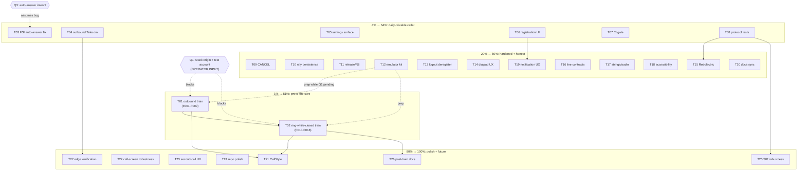

# Pareto Plan — Device-Train Readiness (2026-10-24 17:50)

> **Basis:** `TODO_LIST.md` (14 items), status report
> `docs/status/2026-10-24_17-44_working-app-wiring-and-first-docs-audit.md`
> (50-item backlog), FEATURES/CHANGELOG cross-check. All TODO items verified
> still open against code this session — nothing in this plan re-dispatches
> shipped work. First plan in `docs/planning/` (no priors to read).
>
> **Standing blockers (unanswered questions from the 17:44 report):**
>
> - **Q1 unanswered** → T01/T02 (the device trains) are BLOCKED on operator
>   input: a live stack origin + test extension account. Everything else is
>   executable without it.
> - **Q3 unanswered** → T03 assumes auto-answer-on-FSI-open is a BUG (explicit
>   Answer tap required). One-line reversal if the operator rules otherwise.
> - **Q2 unanswered** → F013 measures the answer-path race empirically; the
>   server-side fix (re-INVITE retry) lives in the webphone repo.
>
> **Verschlimmbesserung guard:** every task must leave the repo verifiably no
> worse: build gate (`assembleDebug` + `zipalign -c -P 16 4`) must pass after
> each code task; no speculative rewrites; ghosts get integrated OR deleted,
> never polished.

## Step 0 — Backlog verification (errata)

All 14 `TODO_LIST.md` items confirmed open by grep this session
(`onCreateOutgoingConnection` zero callers, `onRegistrationState = Unit`,
`bye()` pre-200, hardcoded `App.origin`, no workflows dir, etc.). No errata.
New tasks surfaced by this plan beyond TODO_LIST: F059-F061 (emulator kit),
F070-F072 (Robolectric), F101-F103 (SIP robustness) — already present in the
17:44 report's 50-item list, routed here; TODO_LIST remains the living source.

## Pareto breakdown

| Tier                     | Share of work       | Delivers                   | The tasks                                                                                                                                                               |
| ------------------------ | ------------------- | -------------------------- | ----------------------------------------------------------------------------------------------------------------------------------------------------------------------- |
| **1% → 51%**             | ~2 tasks of ~107    | Proof the app works at all | T01 + T02: the two device trains — outbound E2E and ring-while-closed E2E against the live stack. Until these run, every other improvement polishes an unverified core. |
| **4% → 64%**             | +6 tasks (T03-T08)  | Daily-drivable caller      | FSI auto-answer fix, outbound Telecom visibility, settings surface (real origin), registration-state UI, CI gate, protocol unit tests.                                  |
| **20% → 80%**            | +12 tasks (T09-T20) | Hardened + honest          | CANCEL, ntfy persistence, release/R8, emulator harness, logout hook, dialpad UX, Robolectric, live-contract checks, strings/audio, a11y, notification UX, docs sync.    |
| **Remaining 80% → 100%** | +7 tasks (T21-T27)  | Polish + future-proofing   | CallStyle, robustness audits, second-call UX, repo polish, SIP ladder hardening, post-train docs refresh, edge verification.                                            |

Sequencing rule: 1% first (blocked → prep its unblockers T08/T12 while
waiting), then 4%, then 20%, then the tail. Do not start tail tasks while
4% tasks remain open.

## Comprehensive plan — 27 tasks, 30-100 min each

Sorted by importance / customer value (tier), then impact-to-effort ratio
inside each tier. `BLK` = blocked on operator input.

| #       | Task                                                                                             | Tier     | Impact       | Effort     | Customer value                                                 | Depends on    |
| ------- | ------------------------------------------------------------------------------------------------ | -------- | ------------ | ---------- | -------------------------------------------------------------- | ------------- |
| T01     | Device train 1: outbound call E2E (login→session→REGISTER→dial→audio→BYE)                        | 1%       | Critical     | 100min BLK | The product's core promise proven                              | Q1            |
| T02     | Device train 2: ring-while-closed E2E (push→FSI→answer; race measured)                           | 1%       | Critical     | 100min BLK | The differentiating feature proven                             | Q1, T01       |
| ~~T03~~ | ~~Fix FSI auto-answer (explicit Answer tap)~~ done at `dac60c9`                                  | ~~4%~~   | ~~Critical~~ | ~~30min~~  | ~~Calls never answer from a pocket-wake~~                      | ~~—~~         |
| ~~T04~~ | ~~Wire outbound calls through Telecom (`placeCall`) — de-ghost~~ done at `dac60c9`               | ~~4%~~   | ~~High~~     | ~~100min~~ | ~~BT/watches see outbound calls; OS integration complete~~     | ~~—~~         |
| ~~T05~~ | ~~Settings surface: stack origin persisted (kill hardcoded origin)~~ done at `3a1df59`           | ~~4%~~   | ~~High~~     | ~~100min~~ | ~~App usable against any stack without rebuild~~               | ~~—~~         |
| ~~T06~~ | ~~Expose SIP registration state in CallState + UI badge~~ done at `dac60c9`                      | ~~4%~~   | ~~High~~     | ~~60min~~  | ~~User sees "connected to PBX" instead of flying blind~~       | ~~—~~         |
| ~~T07~~ | ~~CI: assembleDebug + zipalign 16K + dprint check~~ done at `dac60c9`                            | ~~4%~~   | ~~High~~     | ~~60min~~  | ~~The "verified per release in CI" claim becomes true~~        | ~~—~~         |
| ~~T08~~ | ~~Protocol unit tests: SipMessage + Digest + DeviceIdentity~~ done at `dac60c9`                  | ~~4%~~   | ~~High~~     | ~~100min~~ | ~~Every later SIP change stops being a leap of faith~~         | ~~—~~         |
| ~~T09~~ | ~~CANCEL support (hang-up during ring-out)~~ done at `dac60c9`                                   | ~~20%~~  | ~~Med-High~~ | ~~60min~~  | ~~Correct early hang-up across PBX vendors~~                   | ~~—~~         |
| ~~T10~~ | ~~ntfy lane: persist server/topic, survive sticky restart~~ done at `dac60c9`                    | ~~20%~~  | ~~Med-High~~ | ~~30min~~  | ~~De-Googled push stops dying silently~~                       | ~~—~~         |
| ~~T11~~ | ~~assembleRelease + R8 keep verification~~ done at `dac60c9`                                     | ~~20%~~  | ~~Med~~      | ~~30min~~  | ~~Release lane proven (never run)~~                            | ~~—~~         |
| ~~T12~~ | ~~Emulator/device train-kit in devShell~~ done at `dac60c9`                                      | ~~20%~~  | ~~Med-High~~ | ~~100min~~ | ~~Unblocks repeatable verification without operator hardware~~ | ~~—~~         |
| ~~T13~~ | ~~Logout → deregister device (cookie poll or JS bridge)~~ done at `a345360`                      | ~~20%~~  | ~~Med~~      | ~~100min~~ | ~~No ghost rows in the push registry after logout~~            | ~~—~~         |
| ~~T14~~ | ~~Dialpad UX batch: rotation fix, recents, clear, FAB theming~~ done at `dac60c9`                | ~~20%~~  | ~~Med~~      | ~~60min~~  | ~~The most-touched surface stops feeling like scaffold~~       | ~~—~~         |
| ~~T15~~ | ~~Robolectric smoke: MainActivity→CallLayer, RingEvent→notification~~ done at `dac60c9`          | ~~20%~~  | ~~Med~~      | ~~100min~~ | ~~Wiring regressions caught before device~~                    | ~~T08 infra~~ |
| T16     | Live contract checks: session fields, push payload, CSRF                                         | 20%      | Med          | 60min BLK  | Field-drift class of bugs closed                               | T01 access    |
| ~~T17~~ | ~~Strings extraction + speaker routing + audio focus~~ done at `dac60c9`                         | ~~20%~~  | ~~Med~~      | ~~60min~~  | ~~i18n-ready, real speaker toggle, no audio-focus stealing~~   | ~~—~~         |
| ~~T18~~ | ~~Accessibility pass (descriptions, touch targets)~~ done at `dac60c9`                           | ~~20%~~  | ~~Med~~      | ~~60min~~  | ~~Usable beyond perfect eyesight + default motor control~~     | ~~—~~         |
| ~~T19~~ | ~~Notification UX: post-login prompt, unregistered dialer state~~ done at `dac60c9`              | ~~20%~~  | ~~Med~~      | ~~60min~~  | ~~Permission asked in context; dial button honest~~            | ~~T06~~       |
| ~~T20~~ | ~~Docs sync batch: citations, DOMAIN_LANGUAGE, CHANGELOG, status index~~ done at `2653474`       | ~~20%~~  | ~~Med~~      | ~~60min~~  | ~~Docs stop lying about line numbers; harvest loop closed~~    | ~~—~~         |
| T21     | CallStyle-composed notifications (incoming + ongoing)                                            | tail     | Med          | 100min     | Native calling look; platform-polish contract                  | T01/T02 run   |
| ~~T22~~ | ~~CallActivity robustness: onNewIntent re-ring, auto-finish, thread audits~~ done at `dac60c9`   | ~~tail~~ | ~~Med~~      | ~~60min~~  | ~~No zombie screens, no cross-thread state writes~~            | ~~—~~         |
| T23     | Second-incoming-call UX (FSI suppression, busy heads-up)                                         | tail     | Low-Med      | 60min      | Line-busy behaves deliberately, not accidentally               | —             |
| ~~T24~~ | ~~Repo polish: icon, LICENSE, config cache, dependabot ecosystems~~ done at `29c4e45`, `1caa45e` | ~~tail~~ | ~~Low~~      | ~~60min~~  | ~~Looks owned, builds faster, updates itself~~                 | ~~—~~         |
| T25     | SipEngine robustness: INVITE 401 ladder, watchdog silence re-register                            | tail     | Med          | 60min      | Long-lived registration survives PBX quirks                    | T08           |
| T26     | Post-train docs: retire honesty markers, ROADMAP revisit                                         | tail     | Med          | 30min BLK  | README truth matches reality                                   | T01/T02       |
| T27     | Edge verification: cookie-expiry mid-call, TLS pinning memo                                      | tail     | Low          | 60min      | Known behavior at session boundaries                           | T01 access    |

Totals: ~20h across 27 tasks. 2 blocked on operator input (Q1), 2
soft-blocked on train results (T26, part of T16).

## Fine breakdown — 107 tasks, ≤ 12 min each

Sorted by tier (1% → 4% → 20% → tail), then execution order inside each
parent. `BLK` rows need operator input or a prior task.

| ID       | Task (≤12min)                                                                                   | Min    | Parent  | Tier     |
| -------- | ----------------------------------------------------------------------------------------------- | ------ | ------- | -------- |
| F001     | Collect stack facts: origin URL, test extension, `/api/session` response shape (operator input) | 5      | T01     | 1% BLK   |
| F002     | Build + install debug APK on device (`adb install -r`)                                          | 10     | T01     | 1% BLK   |
| F003     | Login in WebView; verify session cookie minted (inspect/logs)                                   | 10     | T01     | 1% BLK   |
| F004     | Verify `/api/session` resume → SIP credentials in logs (field names!)                           | 10     | T01     | 1% BLK   |
| F005     | Verify REGISTER digest challenge → 200 in logs                                                  | 10     | T01     | 1% BLK   |
| F006     | Dial echo-test extension; observe INVITE/180/200/ACK ladder                                     | 12     | T01     | 1% BLK   |
| F007     | Verify two-way audio + mute toggle behavior                                                     | 10     | T01     | 1% BLK   |
| F008     | Hang up; verify BYE, teardown, FGS stop                                                         | 10     | T01     | 1% BLK   |
| F009     | Log findings; flip FEATURES rows for verified items                                             | 12     | T01     | 1% BLK   |
| F010     | Verify `/api/push-devices` 204 both lanes + server row exists                                   | 10     | T02     | 1% BLK   |
| F011     | Kill app; trigger inbound call from another extension                                           | 10     | T02     | 1% BLK   |
| F012     | Verify FSI fires + Telecom connection rings                                                     | 10     | T02     | 1% BLK   |
| F013     | Measure bootstrap race: INVITE landed before answer timeout?                                    | 12     | T02     | 1% BLK   |
| F014     | Answer via FSI; verify 200 OK + audio                                                           | 10     | T02     | 1% BLK   |
| F015     | Answer via BT headset; verify FGS started from `onAnswer`                                       | 12     | T02     | 1% BLK   |
| F016     | `ring_end` path: answered elsewhere → ring stands down everywhere                               | 10     | T02     | 1% BLK   |
| F017     | Decline path: 603; caller sees busy                                                             | 8      | T02     | 1% BLK   |
| F018     | Record race outcome; open webphone-repo issue if re-INVITE missing                              | 12     | T02     | 1% BLK   |
| ~~F019~~ | ~~Remove `answer()` from `CallActivity.startCall()`; keep FGS + render~~ done at `dac60c9`      | ~~8~~  | ~~T03~~ | ~~4%~~   |
| ~~F020~~ | ~~Answer ONLY from Answer button / Telecom `onAnswer`~~ done at `dac60c9`                       | ~~5~~  | ~~T03~~ | ~~4%~~   |
| ~~F021~~ | ~~Rebuild + re-verify ring flow (emulator/device)~~ done at `dac60c9`                           | ~~12~~ | ~~T03~~ | ~~4%~~   |
| ~~F022~~ | ~~Read `TelecomManager.placeCall` contract for self-managed accounts~~ done at `dac60c9`        | ~~10~~ | ~~T04~~ | ~~4%~~   |
| ~~F023~~ | ~~Invoke `placeCall` from the dial path (extras → CallConnectionService)~~ done at `dac60c9`    | ~~12~~ | ~~T04~~ | ~~4%~~   |
| ~~F024~~ | ~~Route `onCreateOutgoingConnection` → `CallEngine.dial` (single path)~~ done at `dac60c9`      | ~~12~~ | ~~T04~~ | ~~4%~~   |
| ~~F025~~ | ~~Wire outgoing connection lifecycle (dialing/active/disconnected events)~~ done at `dac60c9`   | ~~12~~ | ~~T04~~ | ~~4%~~   |
| ~~F026~~ | ~~Delete the now-duplicate direct-dial path (ghost fully integrated)~~ done at `dac60c9`        | ~~10~~ | ~~T04~~ | ~~4%~~   |
| ~~F027~~ | ~~Build + verify BT device observes outbound call state~~ done at `dac60c9`                     | ~~12~~ | ~~T04~~ | ~~4%~~   |
| ~~F028~~ | ~~Add persisted settings storage (DataStore or prefs) for origin~~ done at `3a1df59`            | ~~12~~ | ~~T05~~ | ~~4%~~   |
| ~~F029~~ | ~~Migrate `App.origin` to read-through helper (kept default as fallback)~~ done at `3a1df59`    | ~~10~~ | ~~T05~~ | ~~4%~~   |
| ~~F030~~ | ~~Settings UI: origin input + save (programmatic, house style)~~ done at `3a1df59`              | ~~12~~ | ~~T05~~ | ~~4%~~   |
| ~~F031~~ | ~~First-run "no origin set" prompt routes to settings~~ done at `3a1df59`                       | ~~10~~ | ~~T05~~ | ~~4%~~   |
| ~~F032~~ | ~~Persist + reload origin; CallLayer picks up new value on next wire~~ done at `3a1df59`        | ~~10~~ | ~~T05~~ | ~~4%~~   |
| ~~F033~~ | ~~Add `registrationState` to `CallEngine.CallState`~~ done at `dac60c9`                         | ~~10~~ | ~~T06~~ | ~~4%~~   |
| ~~F034~~ | ~~Implement `onRegistrationState` → state update (no longer `Unit`)~~ done at `dac60c9`         | ~~5~~  | ~~T06~~ | ~~4%~~   |
| ~~F035~~ | ~~Shell status badge near the dial button (registered/connecting/off)~~ done at `dac60c9`       | ~~12~~ | ~~T06~~ | ~~4%~~   |
| ~~F036~~ | ~~Dialer: disable Call button while unregistered + hint text~~ done at `dac60c9`                | ~~10~~ | ~~T06~~ | ~~4%~~   |
| ~~F037~~ | ~~Write `.github/workflows/ci.yml`: JDK 21 + `assembleDebug`~~ done at `dac60c9`                | ~~12~~ | ~~T07~~ | ~~4%~~   |
| ~~F038~~ | ~~Add `zipalign -c -P 16 4` gate step (build-tools 35)~~ done at `dac60c9`                      | ~~12~~ | ~~T07~~ | ~~4%~~   |
| ~~F039~~ | ~~Add `dprint fmt --check` step~~ done at `dac60c9`                                             | ~~10~~ | ~~T07~~ | ~~4%~~   |
| F040     | Triggers: PR + workflow_dispatch; verify first green run                                        | 8      | T07     | 4%       |
| ~~F041~~ | ~~Add test source set + `kotlin.test` deps to `app/build.gradle.kts`~~ done at `dac60c9`        | ~~10~~ | ~~T08~~ | ~~4%~~   |
| ~~F042~~ | ~~SipMessage tests: request parse/render round-trips~~ done at `dac60c9`                        | ~~12~~ | ~~T08~~ | ~~4%~~   |
| ~~F043~~ | ~~SipMessage tests: response parse + CSeq/Call-ID extraction~~ done at `dac60c9`                | ~~12~~ | ~~T08~~ | ~~4%~~   |
| ~~F044~~ | ~~SipMessage tests: malformed input → null (no throw)~~ done at `dac60c9`                       | ~~10~~ | ~~T08~~ | ~~4%~~   |
| ~~F045~~ | ~~Digest tests: MD5 against RFC 2617 vector~~ done at `dac60c9`                                 | ~~10~~ | ~~T08~~ | ~~4%~~   |
| ~~F046~~ | ~~Digest tests: SHA-256 + qop/nc/cnonce variants~~ done at `dac60c9`                            | ~~12~~ | ~~T08~~ | ~~4%~~   |
| ~~F047~~ | ~~DeviceIdentity tests: stable id, 32-hex unguessable topic~~ done at `dac60c9`                 | ~~10~~ | ~~T08~~ | ~~4%~~   |
| ~~F048~~ | ~~Wire `./gradlew test` into CI (after F037)~~ done at `dac60c9`                                | ~~10~~ | ~~T08~~ | ~~4%~~   |
| ~~F049~~ | ~~Add `SipEngine.cancel(callId)` (CANCEL + BYE-after-200 guard)~~ done at `dac60c9`             | ~~12~~ | ~~T09~~ | ~~20%~~  |
| ~~F050~~ | ~~`CallEngine.hangUp`: CANCEL when DIALLING, BYE when ACTIVE~~ done at `dac60c9`                | ~~10~~ | ~~T09~~ | ~~20%~~  |
| ~~F051~~ | ~~Handle 487 Request Terminated → clean teardown (not error)~~ done at `dac60c9`                | ~~10~~ | ~~T09~~ | ~~20%~~  |
| ~~F052~~ | ~~Unit test: hang-up-during-ring-out message sequence~~ done at `dac60c9`                       | ~~12~~ | ~~T09~~ | ~~20%~~  |
| ~~F053~~ | ~~Persist ntfy server/topic to prefs on start~~ done at `dac60c9`                               | ~~10~~ | ~~T10~~ | ~~20%~~  |
| ~~F054~~ | ~~Null-intent sticky restart: read prefs, resubscribe~~ done at `dac60c9`                       | ~~10~~ | ~~T10~~ | ~~20%~~  |
| F055     | Kill/restart test (`adb shell am kill`) — lane survives                                         | 12     | T10     | 20%      |
| ~~F056~~ | ~~Run `assembleRelease`; catalog R8 failures~~ done at `dac60c9`                                | ~~10~~ | ~~T11~~ | ~~20%~~  |
| ~~F057~~ | ~~Add minimal keeps for cataloged failures~~ done at `dac60c9`                                  | ~~10~~ | ~~T11~~ | ~~20%~~  |
| ~~F058~~ | ~~Re-run release + install/launch smoke~~ done at `dac60c9`                                     | ~~10~~ | ~~T11~~ | ~~20%~~  |
| ~~F059~~ | ~~Enable emulator in flake `androidenv` (or document device kit)~~ done at `dac60c9`            | ~~12~~ | ~~T12~~ | ~~20%~~  |
| ~~F060~~ | ~~Script: create AVD + boot + install + screenshot~~ done at `dac60c9`                          | ~~12~~ | ~~T12~~ | ~~20%~~  |
| ~~F061~~ | ~~Document train-kit usage in AGENTS.md~~ done at `dac60c9`                                     | ~~10~~ | ~~T12~~ | ~~20%~~  |
| ~~F062~~ | ~~Cookie-poll watcher in CallLayer (session 401 → deregister)~~ done at `a345360`               | ~~12~~ | ~~T13~~ | ~~20%~~  |
| F063     | Alternative: JS-bridge logout hook (pick ONE with operator)                                     | 12     | T13     | 20%      |
| F064     | Test: island logout → device row removed server-side                                            | 10     | T13     | 20%      |
| ~~F065~~ | ~~Dialpad rotation fix: view IDs / state restoration~~ done at `dac60c9`                        | ~~8~~  | ~~T14~~ | ~~20%~~  |
| ~~F066~~ | ~~Recents: store last 5 dialed numbers (prefs)~~ done at `dac60c9`                              | ~~12~~ | ~~T14~~ | ~~20%~~  |
| ~~F067~~ | ~~Recents chips row in dialpad UI~~ done at `dac60c9`                                           | ~~12~~ | ~~T14~~ | ~~20%~~  |
| ~~F068~~ | ~~Long-press backspace = clear all~~ done at `dac60c9`                                          | ~~8~~  | ~~T14~~ | ~~20%~~  |
| ~~F069~~ | ~~FAB-style theming for the floating dial button~~ done at `dac60c9`                            | ~~12~~ | ~~T14~~ | ~~20%~~  |
| ~~F070~~ | ~~Add Robolectric deps + test config~~ done at `dac60c9`                                        | ~~10~~ | ~~T15~~ | ~~20%~~  |
| ~~F071~~ | ~~Test: MainActivity launch → CallLayer.ensureWired invoked~~ done at `dac60c9`                 | ~~12~~ | ~~T15~~ | ~~20%~~  |
| ~~F072~~ | ~~Test: RingEvent.route ring → notification + telecom (shadowed)~~ done at `dac60c9`            | ~~12~~ | ~~T15~~ | ~~20%~~  |
| F073     | Verify `/api/session` field names live (`sip_domain` vs `sipDomain`)                            | 10     | T16     | 20% BLK  |
| F074     | Verify push payload shapes on both lanes (`event`/`from`/`call_id`)                             | 10     | T16     | 20% BLK  |
| F075     | Verify CSRF dance on `/api/push-devices` POST/DELETE                                            | 10     | T16     | 20% BLK  |
| ~~F076~~ | ~~Extract hardcoded CallActivity strings to `strings.xml`~~ done at `dac60c9`                   | ~~10~~ | ~~T17~~ | ~~20%~~  |
| ~~F077~~ | ~~Wire speaker toggle (dead `speaker` string) or delete it~~ done at `dac60c9`                  | ~~12~~ | ~~T17~~ | ~~20%~~  |
| ~~F078~~ | ~~Audio focus request/release in CallService lifecycle~~ done at `dac60c9`                      | ~~12~~ | ~~T17~~ | ~~20%~~  |
| ~~F079~~ | ~~contentDescription pass: dialpad + in-call buttons~~ done at `dac60c9`                        | ~~12~~ | ~~T18~~ | ~~20%~~  |
| F080     | Touch-target + contrast audit of programmatic UI                                                | 12     | T18     | 20%      |
| ~~F081~~ | ~~Move POST_NOTIFICATIONS prompt to post-login context~~ done at `dac60c9`                      | ~~10~~ | ~~T19~~ | ~~20%~~  |
| ~~F082~~ | ~~Unregistered dialer state messaging (disabled + why)~~ done at `dac60c9`                      | ~~10~~ | ~~T19~~ | ~~20%~~  |
| ~~F083~~ | ~~Refresh all stale `file:line` citations in FEATURES/TODO~~ done at `2653474`                  | ~~12~~ | ~~T20~~ | ~~20%~~  |
| ~~F084~~ | ~~DOMAIN_LANGUAGE: add CallLayer, stand-down, bootstrap race~~ done at `2653474`                | ~~10~~ | ~~T20~~ | ~~20%~~  |
| ~~F085~~ | ~~CHANGELOG: note `.kotlin/` untracking; tag v0.1.0 decision~~ done at `2653474`                | ~~8~~  | ~~T20~~ | ~~20%~~  |
| ~~F086~~ | ~~Create `docs/status/README.md` index (first entry exists)~~ done at `2653474`                 | ~~10~~ | ~~T20~~ | ~~20%~~  |
| ~~F087~~ | ~~AGENTS.md: add test command once F048 lands~~ done at `2653474`                               | ~~8~~  | ~~T20~~ | ~~20%~~  |
| F088     | Notification.CallStyle for incoming (person, answer/decline actions)                            | 12     | T21     | tail     |
| F089     | CallStyle ongoing notification for the active call                                              | 12     | T21     | tail     |
| F090     | Device-verify CallStyle against both trains                                                     | 10     | T21     | tail BLK |
| ~~F091~~ | ~~`onNewIntent` in CallActivity: re-ring while alive updates UI~~ done at `dac60c9`             | ~~12~~ | ~~T22~~ | ~~tail~~ |
| ~~F092~~ | ~~Auto-finish ENDED call screen after timeout~~ done at `dac60c9`                               | ~~8~~  | ~~T22~~ | ~~tail~~ |
| F093     | Thread-safety audit: confine `_state`/pendingInvite writes to one thread                        | 12     | T22     | tail     |
| F094     | Decide + document CallLayer.shutdown vs in-flight ensureWired race                              | 10     | T22     | tail     |
| F095     | Suppress FSI when phase ≠ IDLE (busy path exists in engine)                                     | 10     | T23     | tail     |
| F096     | Busy heads-up variant ("line busy" notification)                                                | 12     | T23     | tail     |
| ~~F097~~ | ~~Real adaptive app icon artwork~~ done at `29c4e45`                                            | ~~12~~ | ~~T24~~ | ~~tail~~ |
| F098     | LICENSE decision + file                                                                         | 10     | T24     | tail     |
| ~~F099~~ | ~~Enable Gradle configuration cache~~ done at `1caa45e`                                         | ~~8~~  | ~~T24~~ | ~~tail~~ |
| ~~F100~~ | ~~Dependabot: add `github-actions` ecosystem~~ done at `1caa45e`                                | ~~8~~  | ~~T24~~ | ~~tail~~ |
| F101     | INVITE 401 re-auth ladder (challenge on INVITE, not just REGISTER)                              | 12     | T25     | tail     |
| F102     | Watchdog: re-register on silence despite live socket                                            | 12     | T25     | tail     |
| F103     | Unit tests for both robustness paths                                                            | 12     | T25     | tail     |
| F104     | Retire honesty-contract markers one by one (README + FEATURES)                                  | 12     | T26     | tail BLK |
| F105     | ROADMAP revisit: multi-line + provisioning decisions                                            | 10     | T26     | tail BLK |
| F106     | Cookie-expiry mid-call behavior check                                                           | 10     | T27     | tail BLK |
| F107     | TLS-pinning consideration memo (decide: pin or not, record why)                                 | 10     | T27     | tail     |

**Totals:** 107 fine tasks, ~18.5h. Blocked on operator (Q1): 18 tasks
(~3h). Executable right now: 89 tasks (~15.5h).

## Execution graph



**Strategy while Q1 is pending:** run the unblocked 4% tier first (T03-T08),
then T12 (emulator kit) — it converts part of the device train into a
self-serve loop and may unblock smoke-testing without operator hardware.

## Verification gate (every code task)

```console
nix develop -c ./gradlew assembleDebug   # must stay green
nix develop -c bash -c '$ANDROID_HOME/build-tools/35.0.0/zipalign -c -P 16 4 app/build/outputs/apk/debug/app-debug.apk'
```

Plus `./gradlew test` once F048 lands. A task that cannot pass the gate is not
done; a "fix" that breaks the gate is a Verschlimmbesserung and gets reverted.
