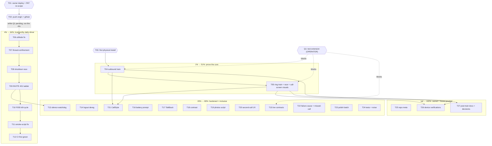

# Pareto Plan — Live Core & Daily Driver (2026-10-25 06:38)

> **Basis:** the rebuilt `TODO_LIST.md` (26 verified rows, 2026-10-25 ~06:00),
> `ROADMAP.md` "Open questions" (6), the annotated corpus
> (`docs/status/2026-10-24_*`, `2026-10-25_*`), and the prior plan
> `docs/planning/2026-10-24_17-50_pareto-device-train-readiness.md` — whose
> 19 T-rows and 66 F-rows carry inline `done at` markers as of the 06:27
> audit. Nothing in this plan re-dispatches shipped work.
>
> **What changed since the prior plan (errata):** the 17:50 plan's
> executable tiers (T03-T24) SHIPPED (see `docs/status/2026-10-24_18-55_*`
> and the strikethroughs in the plan file). The 1% (device trains) is still
> open, but the blocker SHRANK: the stack is UP again (verified 06:00), the
> origin ships as the default, the emulator kit exists — the trains need
> only a test extension + account. New since the prior plan: the push
> mirror is still UNATTACHED and nothing pushes any remote (both lag local),
> the uiMode stale-theme defect is catalogued, and the MVP install path is
> now in README.
>
> **Standing blockers (operator):**
>
> - **Q1 (reduced):** a test extension (+ account if login needs one) for
>   `pbx.artmann.tech`. Blocks T04/T05 and every live-stack row.
> - **Push grant:** agents may not push unasked; AGENTS.md instructs
>   fallback pushes until the mirror attaches. One sentence settles it.
> - **Logout semantics (server-side):** KEEP vs PURGE `/api/push-devices`
>   rows on island logout — decides T14's implementation.
>
> **Verschlimmbesserung guard:** every code task passes the gate
> (`assembleDebug` + `zipalign -c -P 16 4` + `testDebugUnitTest`) before it
> is "done"; no speculative rewrites; ghost systems get integrated OR
> deleted, never polished; behavior freezes before restyling. A fix that
> breaks the gate is reverted, not argued.

## Pareto breakdown

| Tier                     | Share of work        | Delivers                         | The tasks                                                                                                                                                                            |
| ------------------------ | -------------------- | -------------------------------- | ------------------------------------------------------------------------------------------------------------------------------------------------------------------------------------ |
| **1% → 51%**             | ~4 tasks of 27       | A verified working phone         | Owner unblocks (deploy + PAT), push both remotes, first physical install, and the TWO DEVICE TRAINS. Until the trains run, every other line polishes an unverified core.             |
| **4% → 64%**             | +7 tasks (T06-T12)   | A trustworthy daily driver       | uiMode theme fix, thread-confinement audit, shutdown-race decision, INVITE 401 ladder, F055 kill-cycle, smoke-script fix, CI first green run.                                        |
| **20% → 80%**            | +12 tasks (T13-T24)  | Hardened, inclusive, observable  | Watchdog, logout deregistration, live contracts, battery prompt, TalkBack, contrast, photos script, second-call UX, CallStyle, failure-cause/missed-call, polish batch, tests batch. |
| **Remaining 20% → 100%** | +3 batches (T25-T27) | Owned repo + future-proofed edge | Repo meta (LICENSE/TLS/mirror-lag/parity), device-only verifications (AEC/R8/CallEndpoint/FreeSWITCH), post-train docs + decisions sweep.                                            |

Sequencing rule: owner unblocks and the push happen FIRST (minutes); while
Q1 is pending, run the 4% agent tasks in order; the 1% trains fire the
moment the extension lands; 20% follows; the tail never precedes open 20%
work.

## Comprehensive plan — 27 tasks, 30-100 min each

Sorted by tier, then impact-to-effort. `BLK` = blocked on operator input or
a live stack. `Owner` = only the operator can execute.

| #       | Task                                                                                                                                                                                                                                                                | Tier     | Impact       | Effort         | Customer value                                                            | Depends on         |
| ------- | ------------------------------------------------------------------------------------------------------------------------------------------------------------------------------------------------------------------------------------------------------------------- | -------- | ------------ | -------------- | ------------------------------------------------------------------------- | ------------------ |
| T01     | Owner: SystemNix deploy (attach mirror) + PAT `repo`+`workflow` re-scope **→ TODO_LIST (Owner: deploy + PAT re-scope, R12/N025-N026)**                                                                                                                              | 1%       | Critical     | 25min Owner    | History flows again; domains unfreezes (114 behind)                       | —                  |
| ~~T02~~ | ~~Push `origin` + `github` (gap-window discipline)~~ done — pushed 14:33 over SSH, tips equal f585c6d (docs/status/2026-10-25_14-33 §a)                                                                                                                             | ~~1%~~   | ~~Critical~~ | ~~10min~~      | ~~The twin and the canonical repo stop drifting~~                         | ~~T01 (or grant)~~ |
| T03     | First physical install + first-run walk of the redesigned build **→ TODO_LIST (First physical install, R14/N030-N032)**                                                                                                                                             | 1%       | Critical     | 30min          | The actual phone runs the actual app                                      | —                  |
| T04     | Device train 1: outbound E2E (login → REGISTER → dial → audio → BYE) **→ TODO_LIST (outbound device train, R15/N033-N038 — Q1)**                                                                                                                                    | 1%       | Critical     | 100min BLK     | The core promise PROVEN                                                   | Q1, T03            |
| T05     | Device train 2: ring-while-closed E2E + race measurement + call-screen visuals **→ TODO_LIST (ring train + race + call-screen visuals, R16/N039-N044 — Q1)**                                                                                                        | 1%       | Critical     | 100min BLK     | The differentiator PROVEN; the race answered; the one unseen surface SEEN | Q1, T04            |
| ~~T06~~ | ~~Fix the uiMode stale-theme defect (day/night switch)~~ done — docs/status/2026-10-25_10-00 §a T06 + emulator proof (13-43 §a4 F024)                                                                                                                               | ~~4%~~   | ~~High~~     | ~~60min~~      | ~~Correct colors after dark/light switch — a visible lie today~~          | ~~—~~              |
| ~~T07~~ | ~~Thread-confinement audit of `CallEngine` + fixes (F093)~~ done — docs/status/2026-10-25_10-00 §a T07 (single-lock confinement)                                                                                                                                    | ~~4%~~   | ~~High~~     | ~~100min~~     | ~~The one real crash-risk class closed~~                                  | ~~—~~              |
| ~~T08~~ | ~~Decide + fix `shutdown` vs in-flight `ensureWired` race (F094)~~ done — docs/status/2026-10-25_10-00 §a T08 (AttachGuard + 4 tests)                                                                                                                               | ~~4%~~   | ~~High~~     | ~~30min~~      | ~~No orphan engines after settings saves~~                                | ~~—~~              |
| ~~T09~~ | ~~INVITE 401 re-auth ladder + unit tests (F101/F103)~~ done — docs/status/2026-10-25_10-00 §a T09 (SipEngineAuthTest)                                                                                                                                               | ~~4%~~   | ~~High~~     | ~~100min~~     | ~~PBXs that challenge INVITE stop breaking outbound calls~~               | ~~—~~              |
| ~~T10~~ | ~~Execute F055: ntfy `am kill` sticky-restart cycle (+ fix findings)~~ done — docs/status/2026-10-25_13-56 §a F035 (kill-cycle PROVEN, nothing to fix)                                                                                                              | ~~4%~~   | ~~High~~     | ~~30min~~      | ~~The de-Googled ring lane's persistence PROVEN~~                         | ~~—~~              |
| ~~T11~~ | ~~Fix `scripts/emulator-smoke.sh` adb robustness (pin `-s`, fail fast)~~ done — docs/status/2026-10-25_10-00 §a T11 (serial pinning + fail-fast)                                                                                                                    | ~~4%~~   | ~~Med-High~~ | ~~30min~~      | ~~Every future train stops hanging on the dual-server trap~~              | ~~—~~              |
| ~~T12~~ | ~~CI execution home decision + `push` trigger + first green run~~ done — home + trigger decided/added (10-00 §a F040; runs fire); FIRST GREEN → TODO R13 (billing)                                                                                                  | ~~4%~~   | ~~Med-High~~ | ~~60min BLK~~  | ~~The "verified in CI" claim becomes true~~                               | ~~Q-answer~~       |
| ~~T13~~ | ~~Silence watchdog re-register + unit tests (F102/F103)~~ done — docs/status/2026-10-25_10-00 §a T13 (SipEngineSilenceTest)                                                                                                                                         | ~~20%~~  | ~~Med-High~~ | ~~60min~~      | ~~Long-lived registrations survive silent socket death~~                  | ~~T09 seams~~      |
| T14     | Logout deregistration: operator pick → implement (JS bridge or cookie-poll confirm) **→ TODO_LIST (Logout deregistration KEEP-vs-PURGE, R21/N054-N056)**                                                                                                            | 20%      | Med-High     | 100min BLK     | No ghost rows in the push registry after logout                           | Q-answer           |
| T15     | Live contract checks: session fields, payload shapes, CSRF (F073-F075) **→ TODO_LIST (Live contract checks, R20/N052-N053 — Q1)**                                                                                                                                   | 20%      | Med          | 60min BLK      | The field-drift bug class closed                                          | Q1                 |
| ~~T16~~ | ~~Battery-optimization exemption prompt for the ntfy lane~~ done — docs/status/2026-10-25_10-00 §a T16 (ask shipped; allow/deny verify → TODO R23)                                                                                                                  | ~~20%~~  | ~~Med~~      | ~~60min~~      | ~~The #1 missed-ring cause (OEM killers) addressed~~                      | ~~—~~              |
| ~~T17~~ | ~~TalkBack pass over every programmatic surface~~ done — docs/status/2026-10-25_10-00 §a T17 (a11y code pass; TalkBack on device → TODO R23)                                                                                                                        | ~~20%~~  | ~~Med~~      | ~~60min~~      | ~~Usable without eyesight~~                                               | ~~—~~              |
| ~~T18~~ | ~~Contrast audit of the token palette (badge/status colors)~~ done — docs/status/2026-10-25_10-00 §a T18 + CI contrast gate (13-43 P10)                                                                                                                             | ~~20%~~  | ~~Med~~      | ~~60min~~      | ~~Legible in sunlight and low vision~~                                    | ~~—~~              |
| ~~T19~~ | ~~Promote the photo pipeline into `scripts/emulator-photos.sh`~~ done — docs/status/2026-10-25_10-00 §a F057 (+ light/dark run 13-43 F058)                                                                                                                          | ~~20%~~  | ~~Med~~      | ~~60min~~      | ~~The screenshot lessons stop dying with sessions~~                       | ~~—~~              |
| ~~T20~~ | ~~Second-call busy heads-up + FSI suppression (F095/F096)~~ done — docs/status/2026-10-25_10-00 §a T20/T22 (missed-call policy, Robolectric-pinned)                                                                                                                 | ~~20%~~  | ~~Med~~      | ~~60min~~      | ~~Line-busy behaves deliberately~~                                        | ~~—~~              |
| ~~T21~~ | ~~CallStyle incoming + ongoing notifications (F088/F089)~~ done — docs/status/2026-10-25_10-00 §a T21 (CallStyle + fallbacks; device verify → TODO R23)                                                                                                             | ~~20%~~  | ~~Med~~      | ~~100min~~     | ~~The platform-native calling look~~                                      | ~~T04/T05~~        |
| ~~T22~~ | ~~Registration-failure cause display + missed-call notification~~ done — docs/status/2026-10-25_10-00 §a T22 (badge/dialer cause + missed-call notes)                                                                                                               | ~~20%~~  | ~~Med~~      | ~~60min~~      | ~~The UI explains itself; silent losses become visible~~                  | ~~—~~              |
| ~~T23~~ | ~~Dialpad/call-screen polish: recents refresh, duration timer, haptics~~ done — docs/status/2026-10-25_10-00 §a T23 (recents, duration clock, haptics)                                                                                                              | ~~20%~~  | ~~Low-Med~~  | ~~60min~~      | ~~The most-touched surfaces feel finished~~                               | ~~—~~              |
| ~~T24~~ | ~~Tests + noise batch: SettingsActivity test, hangUp test, AGP warning, local.properties, .kotlin note + tag decision~~ done — docs/status/2026-10-25_10-00 §a F070-F073 + CHANGELOG note (13-56); the TAG → TODO R24 (operator)                                    | ~~20%~~  | ~~Low-Med~~  | ~~100min~~     | ~~Debt swept in one pass; CI noise gone~~                                 | ~~—~~              |
| ~~T25~~ | ~~Repo meta batch: LICENSE, TLS memo, Forgejo description, mirror-lag port, icon parity, API 31-33 decision doc~~ done — LICENSE (10-00 F075), TLS + API 31-33 (ROADMAP), mirror-lag (10-00 F078); Forgejo desc + icon parity → TODO R25                            | ~~tail~~ | ~~Low-Med~~  | ~~100min~~     | ~~The repo looks owned; decisions recorded~~                              | ~~—~~              |
| ~~T26~~ | ~~Device-verification batch: AEC/NS, R8 real call, CallEndpoint decision, FreeSWITCH CANCEL-vs-BYE, release smoke mode, WorkManager evaluation~~ done — decisions in ROADMAP; --release smoke GREEN (13-56 W180); AEC/R8/CANCEL → TODO trains R15/R16               | ~~tail~~ | ~~Med~~      | ~~100min BLK~~ | ~~Audio + release + reconnect truth, on hardware~~                        | ~~T04/T05~~        |
| T27     | Post-train docs + decisions sweep: honesty-marker retirement, ROADMAP revisit, CHANGELOG cut, FCM, crash reporting, WebView dark-mode, visibility, snapshots, baseline profiles **→ TODO_LIST (post-train docs + decisions sweep, R26/N066-N068 + visibility R27)** | tail     | Med          | 100min BLK     | README truth matches reality; futures decided                             | T04/T05            |

Totals: ~33h across 27 tasks. Owner-gated: T01 (25min). BLK on Q1/live
stack: T04, T05, T15, T26, T27, part of T21. BLK on a decision: T12, T14.

## Fine breakdown — 92 tasks, ≤ 12 min each

Sorted by tier then parent. `BLK` rows need operator input, a live stack,
or a prior task. Every TODO_LIST row, ROADMAP idea, and open question is
covered here.

<!-- check-rows:ledger -->

| ID       | Task (≤12min)                                                                                                                                                                                                                 | Min    | Parent  | Tier         |
| -------- | ----------------------------------------------------------------------------------------------------------------------------------------------------------------------------------------------------------------------------- | ------ | ------- | ------------ |
| F001     | Owner: run `nix run .#deploy` in SystemNix — phase 5 attaches the push mirror **→ TODO_LIST (Owner: SystemNix deploy, R12/N025)**                                                                                             | 10     | T01     | 1% Owner     |
| F002     | Owner: regenerate the sync PAT (repo+workflow), update the sops secret, redeploy **→ TODO_LIST (Owner: PAT repo+workflow, R12/N026)**                                                                                         | 15     | T01     | 1% Owner     |
| F003     | Verify end-to-end mirror sync: commit → twin advances; run the AGENTS.md lag probe **→ TODO_LIST (mirror-lag verify after the deploy, R12/N028)**                                                                             | 10     | T01     | 1%           |
| ~~F004~~ | ~~`git push origin main && git push github main`; verify equal tips~~ done — pushed 14:33, tips equal f585c6d (14-33 §a)                                                                                                      | ~~10~~ | ~~T02~~ | ~~1%~~       |
| F005     | Rebuild fresh (`assembleDebug`); never trust a stale APK **→ TODO_LIST (fresh APK, R14/N030)**                                                                                                                                | 10     | T03     | 1%           |
| F006     | `adb install -r` onto the phone; grant mic + notifications **→ TODO_LIST (adb install + grants, R14/N031)**                                                                                                                   | 10     | T03     | 1%           |
| F007     | First-run walk: origin check, island login, badge REGISTERED, battery Unrestricted **→ TODO_LIST (first-run walk, R14/N032)**                                                                                                 | 10     | T03     | 1%           |
| F008     | Collect stack facts: test extension, account, `/api/session` shape (operator) **→ TODO_LIST (Q1 stack facts, R15/N033)**                                                                                                      | 10     | T04     | 1% BLK       |
| F009     | Verify island login mints the cookie; `/api/session` resume returns SIP facts **→ TODO_LIST (login mints cookie; session resume, R15/N034)**                                                                                  | 10     | T04     | 1% BLK       |
| F010     | Verify REGISTER digest challenge → 200 in logs **→ TODO_LIST (REGISTER digest → 200, R15/N035)**                                                                                                                              | 10     | T04     | 1% BLK       |
| F011     | Dial echo extension; observe INVITE/180/200/ACK ladder **→ TODO_LIST (echo extension INVITE ladder, R15/N036)**                                                                                                               | 12     | T04     | 1% BLK       |
| F012     | Verify two-way audio + mute behavior **→ TODO_LIST (two-way audio + AEC/NS, R15/N037)**                                                                                                                                       | 10     | T04     | 1% BLK       |
| F013     | Hang up; verify CANCEL/BYE path, teardown, FGS stop **→ TODO_LIST (CANCEL/BYE teardown + FGS stop, R15/N038)**                                                                                                                | 10     | T04     | 1% BLK       |
| F014     | Log findings; flip FEATURES rows; retire honesty markers this train proves **→ TODO_LIST (train findings → FEATURES flips, R26/N066)**                                                                                        | 12     | T04     | 1% BLK       |
| F015     | Verify `/api/push-devices` rows exist for both lanes **→ TODO_LIST (push-device rows both lanes, R16/N039)**                                                                                                                  | 10     | T05     | 1% BLK       |
| F016     | Kill the app; trigger inbound from the second extension **→ TODO_LIST (inbound trigger, R16/N040)**                                                                                                                           | 10     | T05     | 1% BLK       |
| F017     | Verify FSI + Telecom connection ring; measure the bootstrap race (F013-old) **→ TODO_LIST (FSI + Telecom ring; race measurement, R16/N041)**                                                                                  | 12     | T05     | 1% BLK       |
| F018     | Answer via explicit tap; verify 200 OK + audio **→ TODO_LIST (explicit-tap + BT/watch answers, R16/N042)**                                                                                                                    | 10     | T05     | 1% BLK       |
| F019     | Answer via BT/watch; verify FGS start; log-or-handle the `onAnswer` `runCatching` swallow (17:44 f31) **→ TODO_LIST (BT/watch FGS start + onAnswer log check — R16/N042; the swallow now logs, verified in code 2026-10-28)** | 12     | T05     | 1% BLK       |
| F020     | `ring_end` stands down everywhere; decline path sends 603 **→ TODO_LIST (ring_end stand-down + 603 decline, R16/N043)**                                                                                                       | 10     | T05     | 1% BLK       |
| F021     | Screenshot the redesigned call screen ringing/active/ended (the never-SEEN surface) **→ TODO_LIST (call-screen screenshots ringing/active/ended, R16/N044)**                                                                  | 12     | T05     | 1% BLK       |
| ~~F022~~ | ~~Decide: re-resolve token colors on `onConfigurationChanged` vs drop `uiMode`~~ done — docs/status/2026-10-25_13-56_superb-pass-verification-hardening-and-docs-truth.md §a F024 (root fix shipped, emulator-proven)         | ~~10~~ | ~~T06~~ | ~~4%~~       |
| ~~F023~~ | ~~Implement the chosen fix~~ done — docs/status/2026-10-25_13-56_superb-pass-verification-hardening-and-docs-truth.md §a F024 (uiMode dropped from configChanges)                                                             | ~~12~~ | ~~T06~~ | ~~4%~~       |
| ~~F024~~ | ~~Emulator-verify light↔dark switch renders correct colors~~ done — docs/status/2026-10-25_13-56_superb-pass-verification-hardening-and-docs-truth.md §a F024 (logcat 10:38:08 recreation proven)                             | ~~12~~ | ~~T06~~ | ~~4%~~       |
| ~~F025~~ | ~~Map every `_state`/`pendingInvite`/`media` writer (WebRTC, OkHttp, UI threads)~~ done — docs/status/2026-10-25_10-00_execution-pass-core-hardening-and-surface-modernization.md §a T07                                      | ~~12~~ | ~~T07~~ | ~~4%~~       |
| ~~F026~~ | ~~Confine `pendingInvite`/`media` writes (handler or single thread)~~ done — docs/status/2026-10-25_10-00_execution-pass-core-hardening-and-surface-modernization.md §a T07 (single-lock confinement)                         | ~~12~~ | ~~T07~~ | ~~4%~~       |
| ~~F027~~ | ~~Audit `_state` transitions for cross-thread hazards; fix findings~~ done — docs/status/2026-10-25_10-00_execution-pass-core-hardening-and-surface-modernization.md §a T07 (atomic RMW, @Volatile legs)                      | ~~12~~ | ~~T07~~ | ~~4%~~       |
| ~~F028~~ | ~~Gate: build + full test suite green after confinement changes~~ done — docs/status/2026-10-25_10-00_execution-pass-core-hardening-and-surface-modernization.md §a (55-test gate green)                                      | ~~10~~ | ~~T07~~ | ~~4%~~       |
| ~~F029~~ | ~~Decide the shutdown-vs-ensureWired semantics (document the chosen invariant)~~ done — docs/status/2026-10-25_10-00_execution-pass-core-hardening-and-surface-modernization.md §a T08 (AttachGuard invariant)                | ~~10~~ | ~~T08~~ | ~~4%~~       |
| ~~F030~~ | ~~Implement the guard (post-shutdown re-attach refused or teardown-safe) + test~~ done — docs/status/2026-10-25_10-00_execution-pass-core-hardening-and-surface-modernization.md §a T08 (4 tests)                             | ~~12~~ | ~~T08~~ | ~~4%~~       |
| ~~F031~~ | ~~Implement INVITE-challenge handling (401/407 on INVITE → re-INVITE with auth)~~ done — docs/status/2026-10-25_10-00_execution-pass-core-hardening-and-surface-modernization.md §a T09                                       | ~~12~~ | ~~T09~~ | ~~4%~~       |
| ~~F032~~ | ~~Unit tests: INVITE 401 ladder against the RFC vectors~~ done — docs/status/2026-10-25_10-00_execution-pass-core-hardening-and-surface-modernization.md §a T09 (6 tests in SipEngineAuthTest)                                | ~~12~~ | ~~T09~~ | ~~4%~~       |
| ~~F033~~ | ~~Edge: stale-nonce retry + the multi-qop lessons applied to INVITE~~ done — docs/status/2026-10-25_10-00_execution-pass-core-hardening-and-surface-modernization.md §a T09 (stale=true grace, multi-qop)                     | ~~12~~ | ~~T09~~ | ~~4%~~       |
| ~~F034~~ | ~~Gate: build + tests green~~ done — docs/status/2026-10-25_10-00_execution-pass-core-hardening-and-surface-modernization.md §a (55-test gate green)                                                                          | ~~10~~ | ~~T09~~ | ~~4%~~       |
| ~~F035~~ | ~~Execute the `adb shell am kill` cycle; verify null-intent restart resubscribes~~ done — docs/status/2026-10-25_13-56_superb-pass-verification-hardening-and-docs-truth.md §a F035 (restart resubscribed)                    | ~~12~~ | ~~T10~~ | ~~4%~~       |
| ~~F036~~ | ~~Fix whatever the kill-cycle breaks; re-run until the lane survives~~ done — docs/status/2026-10-25_13-56_superb-pass-verification-hardening-and-docs-truth.md §a F035/F036 (nothing to fix)                                 | ~~12~~ | ~~T10~~ | ~~4%~~       |
| ~~F037~~ | ~~Pin `-s <serial>` + add the second-device fail-fast guard to the smoke script~~ done — docs/status/2026-10-25_10-00_execution-pass-core-hardening-and-surface-modernization.md §a T11 (serial pinning both scripts)         | ~~12~~ | ~~T11~~ | ~~4%~~       |
| ~~F038~~ | ~~Dry-run the fixed script end-to-end (boot → install → launch)~~ done — docs/status/2026-10-25_13-56_superb-pass-verification-hardening-and-docs-truth.md §a F038 (boot→install→launch clean)                                | ~~12~~ | ~~T11~~ | ~~4%~~       |
| ~~F039~~ | ~~Owner decision: GitHub Actions push trigger vs Forgejo native runner~~ done — docs/status/2026-10-25_10-00_execution-pass-core-hardening-and-surface-modernization.md §a F040 (GitHub Actions chosen, recorded)             | ~~10~~ | ~~T12~~ | ~~4% BLK~~   |
| ~~F040~~ | ~~Add the `push: branches: [main]` trigger (or `.forgejo/workflows` port)~~ done — docs/status/2026-10-25_10-00_execution-pass-core-hardening-and-surface-modernization.md §a F040 (trigger in ci.yml; runs fire)             | ~~10~~ | ~~T12~~ | ~~4%~~       |
| F041     | Verify the FIRST green CI run; fix runner assumptions it exposes **→ TODO_LIST (first green CI run, R13/N029 — billing)**                                                                                                     | 12     | T12     | 4%           |
| ~~F042~~ | ~~Implement silence detection (registration expired despite live socket)~~ done — docs/status/2026-10-25_10-00_execution-pass-core-hardening-and-surface-modernization.md §a T13                                              | ~~12~~ | ~~T13~~ | ~~20%~~      |
| ~~F043~~ | ~~Re-register on silence; unit tests for both watchdog paths~~ done — docs/status/2026-10-25_10-00_execution-pass-core-hardening-and-surface-modernization.md §a T13 (SipEngineSilenceTest)                                   | ~~12~~ | ~~T13~~ | ~~20%~~      |
| ~~F044~~ | ~~Gate: build + tests green~~ done — docs/status/2026-10-25_10-00_execution-pass-core-hardening-and-surface-modernization.md §a (55-test gate green)                                                                          | ~~10~~ | ~~T13~~ | ~~20%~~      |
| F045     | Operator: KEEP-vs-PURGE answer for `/api/push-devices` on logout **→ TODO_LIST (KEEP-vs-PURGE answer, R21/N054)**                                                                                                             | 5      | T14     | 20% BLK      |
| F046     | Implement the chosen path (JS-bridge deregister, or confirm cookie-poll suffices) **→ TODO_LIST (implement chosen path, R21/N055)**                                                                                           | 12     | T14     | 20%          |
| F047     | Verify server-side row removal on island logout **→ TODO_LIST (server-side row removal verify, R21/N056)**                                                                                                                    | 10     | T14     | 20% BLK      |
| F048     | Verify `/api/session` field names live (`sip_domain` vs camelCase) **→ TODO_LIST (session field names live, R20/N052)**                                                                                                       | 10     | T15     | 20% BLK      |
| F049     | Verify push payload shapes on both lanes **→ TODO_LIST (payload shapes live, R20/N052)**                                                                                                                                      | 10     | T15     | 20% BLK      |
| F050     | Verify the CSRF dance on `/api/push-devices` POST/DELETE **→ TODO_LIST (CSRF dance live, R20/N053)**                                                                                                                          | 10     | T15     | 20% BLK      |
| ~~F051~~ | ~~Implement the battery-exemption request (post-registration context)~~ done — docs/status/2026-10-25_10-00_execution-pass-core-hardening-and-surface-modernization.md §a T16                                                 | ~~12~~ | ~~T16~~ | ~~20%~~      |
| F052     | Emulator-verify allow/deny paths + the settings deep-link **→ TODO_LIST (battery allow/deny verify, R23/N061)**                                                                                                               | 12     | T16     | 20%          |
| F053     | TalkBack walkthrough: dialpad, in-call, settings, shell **→ TODO_LIST (TalkBack walkthrough, R23/N060)**                                                                                                                      | 12     | T17     | 20%          |
| F054     | Fix labels, focus order, announcements found by the pass                                                                                                                                                                      | 12     | T17     | 20%          |
| ~~F055~~ | ~~Contrast-audit the `wp*` palette (badge/status/buttons)~~ done — docs/status/2026-10-25_10-00_execution-pass-core-hardening-and-surface-modernization.md §a T18 (31 pairs computed)                                         | ~~12~~ | ~~T18~~ | ~~20%~~      |
| ~~F056~~ | ~~Fix failing pairs as token changes (never hardcoded colors)~~ done — docs/status/2026-10-25_10-00_execution-pass-core-hardening-and-surface-modernization.md §a T18 (3 failures as token changes)                           | ~~12~~ | ~~T18~~ | ~~20%~~      |
| ~~F057~~ | ~~Write `scripts/emulator-photos.sh` from the AGENTS.md lessons (serial-pin, root, waits)~~ done — docs/status/2026-10-25_10-00_execution-pass-core-hardening-and-surface-modernization.md §a F057 (script shipped)           | ~~12~~ | ~~T19~~ | ~~20%~~      |
| ~~F058~~ | ~~Verify: capture light + dark screenshots in one clean run~~ done — docs/status/2026-10-25_13-56_superb-pass-verification-hardening-and-docs-truth.md §a F058 (photos/shell-{light,dark}.png)                                | ~~12~~ | ~~T19~~ | ~~20%~~      |
| ~~F059~~ | ~~Implement busy heads-up notification for a second incoming call~~ done — docs/status/2026-10-25_10-00_execution-pass-core-hardening-and-surface-modernization.md §a T20/T22 (missed-call note, no second line)              | ~~12~~ | ~~T20~~ | ~~20%~~      |
| ~~F060~~ | ~~Suppress FSI when phase ≠ IDLE; unit-test the busy path~~ done — docs/status/2026-10-25_10-00_execution-pass-core-hardening-and-surface-modernization.md §a T20/T22 (Robolectric-pinned busy case)                          | ~~12~~ | ~~T20~~ | ~~20%~~      |
| ~~F061~~ | ~~CallStyle incoming notification (person, answer/decline actions)~~ done — docs/status/2026-10-25_10-00_execution-pass-core-hardening-and-surface-modernization.md §a T21                                                    | ~~12~~ | ~~T21~~ | ~~20%~~      |
| ~~F062~~ | ~~CallStyle ongoing notification for the active call~~ done — docs/status/2026-10-25_10-00_execution-pass-core-hardening-and-surface-modernization.md §a T21 (hang-up action + fallbacks)                                     | ~~12~~ | ~~T21~~ | ~~20%~~      |
| F063     | Device-verify CallStyle against both trains (BLK until T04/T05) **→ TODO_LIST (CallStyle device verification, R23/N059)**                                                                                                     | 10     | T21     | 20% BLK      |
| ~~F064~~ | ~~Render registration-failure cause (network vs 401) on badge/dialer~~ done — docs/status/2026-10-25_10-00_execution-pass-core-hardening-and-surface-modernization.md §a T22 (badge + dialer cause)                           | ~~12~~ | ~~T22~~ | ~~20%~~      |
| ~~F065~~ | ~~Missed-call notification when `ring_end` lands unanswered~~ done — docs/status/2026-10-25_10-00_execution-pass-core-hardening-and-surface-modernization.md §a T20/T22                                                       | ~~12~~ | ~~T22~~ | ~~20%~~      |
| ~~F066~~ | ~~Strings + states for both; gate green~~ done — docs/status/2026-10-25_10-00_execution-pass-core-hardening-and-surface-modernization.md §a (strings shipped, gate green)                                                     | ~~10~~ | ~~T22~~ | ~~20%~~      |
| ~~F067~~ | ~~Recents chips refresh after a call without activity recreation~~ done — docs/status/2026-10-25_10-00_execution-pass-core-hardening-and-surface-modernization.md §a T23                                                      | ~~12~~ | ~~T23~~ | ~~20%~~      |
| ~~F068~~ | ~~In-call duration timer on the call screen~~ done — docs/status/2026-10-25_10-00_execution-pass-core-hardening-and-surface-modernization.md §a T23 (Active · m:ss)                                                           | ~~12~~ | ~~T23~~ | ~~20%~~      |
| ~~F069~~ | ~~Haptic feedback on dialpad keys~~ done — docs/status/2026-10-25_10-00_execution-pass-core-hardening-and-surface-modernization.md §a T23                                                                                     | ~~10~~ | ~~T23~~ | ~~20%~~      |
| ~~F070~~ | ~~Robolectric test: SettingsActivity save flow~~ done — docs/status/2026-10-25_10-00_execution-pass-core-hardening-and-surface-modernization.md §a F070 (2 tests)                                                             | ~~12~~ | ~~T24~~ | ~~20%~~      |
| ~~F071~~ | ~~Engine-level test: `CallEngine.hangUp` phase dispatch~~ done — docs/status/2026-10-25_10-00_execution-pass-core-hardening-and-surface-modernization.md §a F071 (5 tests)                                                    | ~~12~~ | ~~T24~~ | ~~20%~~      |
| ~~F072~~ | ~~Suppress the AGP-vs-compileSdk-36 warning (property or AGP bump)~~ done — docs/status/2026-10-25_10-00_execution-pass-core-hardening-and-surface-modernization.md §a F072 (gradle.properties property)                      | ~~10~~ | ~~T24~~ | ~~20%~~      |
| ~~F073~~ | ~~Remove the dead `local.properties` sdk.dir~~ done — docs/status/2026-10-25_10-00_execution-pass-core-hardening-and-surface-modernization.md §a F073 (trashed, build green)                                                  | ~~5~~  | ~~T24~~ | ~~20%~~      |
| ~~F074~~ | ~~CHANGELOG: `.kotlin/` note + the v0.1.0 git-tag decision executed~~ done — CHANGELOG .kotlin/ note landed (13-56 §a); the TAG → TODO R24/N062 (operator)                                                                    | ~~10~~ | ~~T24~~ | ~~20%~~      |
| ~~F075~~ | ~~LICENSE decision + file~~ done — docs/status/2026-10-25_10-00_execution-pass-core-hardening-and-surface-modernization.md §a F075 (MIT)                                                                                      | ~~10~~ | ~~T25~~ | ~~tail~~     |
| ~~F076~~ | ~~TLS-pinning memo: decide pin-or-not, record why (slipped 3 sessions)~~ done — ROADMAP.md Decisions (NOT pinned, why recorded; landed 3b3d723)                                                                               | ~~10~~ | ~~T25~~ | ~~tail~~     |
| F077     | Set the Forgejo repo description (UI or one API call) **→ TODO_LIST (Forgejo repo description, R25/N064 — token)**                                                                                                            | 10     | T25     | tail BLK     |
| ~~F078~~ | ~~Port `scripts/mirror-lag.sh` from domains (or fleet-shared variant)~~ done — docs/status/2026-10-25_10-00_execution-pass-core-hardening-and-surface-modernization.md §a F078 (ported from domains)                          | ~~12~~ | ~~T25~~ | ~~tail~~     |
| F079     | Icon parity: execute the both-or-neither decision **→ TODO_LIST (icon parity both-or-neither, R25/N065)**                                                                                                                     | 12     | T25     | tail BLK     |
| ~~F080~~ | ~~Document the API 31-33 outbound fallback as permanent (or plan reflection)~~ done — ROADMAP.md Decisions (permanent until minSdk 34; landed 3b3d723)                                                                        | ~~10~~ | ~~T25~~ | ~~tail~~     |
| F081     | Verify AEC/NS engages on real hardware (audio-quality check) **→ TODO_LIST (AEC/NS on hardware, R15/N037)**                                                                                                                   | 10     | T26     | tail BLK     |
| F082     | Verify webrtc consumer R8 rules against a REAL call in the release build **→ TODO_LIST (webrtc R8 vs a REAL release call, R15/R16)**                                                                                          | 12     | T26     | tail BLK     |
| ~~F083~~ | ~~`CallEndpoint`-based speaker routing decision (align with addCall)~~ done — ROADMAP.md Decisions (setCommunicationDevice for v0.1; landed 3b3d723)                                                                          | ~~10~~ | ~~T26~~ | ~~tail~~     |
| F084     | Confirm FreeSWITCH sends CANCEL (not BYE) when the caller gives up **→ TODO_LIST (FreeSWITCH CANCEL-vs-BYE, R16/N038)**                                                                                                       | 10     | T26     | tail BLK     |
| ~~F085~~ | ~~Add the debug-signed release smoke mode to the train script~~ done — docs/status/2026-10-25_10-00_execution-pass-core-hardening-and-surface-modernization.md §a F085 (--release smoke mode)                                 | ~~12~~ | ~~T26~~ | ~~tail~~     |
| ~~F086~~ | ~~Evaluate WorkManager as the ntfy reconnect fallback (decide + record)~~ done — ROADMAP.md Decisions (REJECTED for v0.1; landed 3b3d723)                                                                                     | ~~12~~ | ~~T26~~ | ~~tail~~     |
| F087     | Retire the honesty-contract markers the trains proved (README + FEATURES) **→ TODO_LIST (post-train honesty retirement, R26/N066)**                                                                                           | 12     | T27     | tail BLK     |
| F088     | ROADMAP revisit: multi-line, provisioning, post-train themes **→ TODO_LIST (ROADMAP revisit multi-line/provisioning, R26/N067)**                                                                                              | 10     | T27     | tail BLK     |
| F089     | CHANGELOG: cut the next version section; tag the release **→ TODO_LIST (CHANGELOG cut + tag, R24/N063 / R26/N068)**                                                                                                           | 10     | T27     | tail BLK     |
| ~~F090~~ | ~~FCM lane enablement when `google-services.json` exists (operator drop-in)~~ done — AGENTS.md gotcha (dormant-by-default drop-in documented; landed 3b3d723)                                                                 | ~~10~~ | ~~T27~~ | ~~tail BLK~~ |
| ~~F091~~ | ~~Crash-reporting decision: self-hosted ACRA or none by policy~~ done — ROADMAP.md Decisions (none by policy; landed 3b3d723)                                                                                                 | ~~10~~ | ~~T27~~ | ~~tail~~     |
| ~~F092~~ | ~~Remaining decisions sweep: WebView dark-mode, visibility end-state, emulator snapshots, baseline profiles (decide + record)~~ done — ROADMAP.md Decisions (dark-mode, chrome, snapshots, profiles; landed 3b3d723)          | ~~12~~ | ~~T27~~ | ~~tail~~     |

**Totals:** 92 fine tasks, ~16h. Owner-gated: 2 (F001-F002). BLK on
Q1/live stack: 24 tasks (~4.5h). BLK on a decision: 6. Executable by an
agent RIGHT NOW: ~60 tasks (~10h).

## Execution graph



## Verification gate (every code task)

```console
nix develop -c ./gradlew assembleDebug        # must stay green
nix develop -c ./gradlew testDebugUnitTest    # 25 tests must stay green
zipalign -c -P 16 4 app/build/outputs/apk/debug/app-debug.apk   # build-tools 35
nix run nixpkgs#dprint -- fmt                 # touched .md/.yml files
```

A task that cannot pass the gate is not done; a "fix" that breaks the gate
is a Verschlimmbesserung and gets reverted.

## Harvest note

This plan is a snapshot; `TODO_LIST.md` is the living source. Everything
here already lives there or in `ROADMAP.md` (harvested 06:00 this day) —
no new items surfaced by this ranking, so no re-harvest is needed. When
tasks ship, strike them here via docs-health ANNOTATE and remove them from
TODO_LIST.
