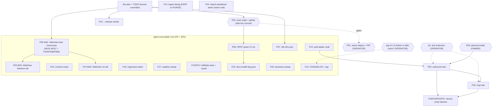

# SUPERB — Post-Hardening Verification & Daily-Driver Plan (2026-10-25 10:17)

> **Execution errata (2026-10-25 ~13:30 pass, second session):**
>
> - **P09 SHIPPED** (W110–W114): `DownloadListener` (same-origin downloads
>   ride DownloadManager WITH the session cookie; foreign hand off),
>   HTTP-error policy DECIDED + documented (`onReceivedHttpError` no-op:
>   origin pages render, overlay stays transport-only), 5 delegation
>   tests. Gate: 60 tests green.
> - **P10 SHIPPED** (W115–W116): `scripts/contrast-check.py` +
>   `scripts/contrast-pairs.json` (50 checks, both modes, glass
>   compositing, fail-exit proven) + CI step; dark `wp_danger` made
>   text-grade (#F87171, 6.1:1 — reserved token, was 4.31:1 nowhere-grade).
> - **P06 PARTIAL**: new `scripts/emulator-verify.sh` verified W101 (dark
>   seam: mean 243→146, dominant `#12151B`), W102 (light back), W103
>   (offline overlay: exact `#F5F8F7` fill + accent retry; Retry recovers),
>   W107 (renderer kill: app pid SURVIVES, origin reloads), F024 (dialpad
>   152/249), F038 (smoke dry run OK), F058 (the PNG set). NOT verifiable
>   headless: W104 attach, W105 external link, W106 back-nav — need a
>   logged-in session (Q1).
> - **P07**: mechanism verified by code read — a fresh emulator has no
>   server/topic in prefs so the FGS self-stops BEFORE `am kill`
>   (`START_NOT_STICKY` on missing config is BY DESIGN); the live
>   kill-cycle needs a configured session. Re-ranked BLOCKED, not broken.
> - **P08**: push trigger VERIFIED (both pushes fired runs) but GitHub
>   refuses to start jobs — "recent account payments have failed or your
>   spending limit needs to be increased" (billing, owner action; no
>   workflow bug). All dependabot-era runs failed identically.
> - Gate moved again: the verification bar is now **60 tests**.
> - Emulator lifetime gotcha (new): host-side detached emulators get
>   reaped within ~2 min of their parent shell; the verify script owns
>   its emulator start-to-finish because of it.
>
> **Basis:** the prior plan `2026-10-25_06-38_pareto-live-core-and-daily-driver-plan.md`
> (27 T-tasks / 92 F-tasks), the execution report
> `docs/status/2026-10-25_10-00_execution-pass-core-hardening-and-surface-modernization.md`
> (07:30–10:00 pass, gate green at 55 tests), and the WebView-train report
> `docs/status/2026-10-25_09-59_webview-optimization-status-and-self-review.md`
> (concurrent session; `shell/WebSurface.kt` + 9 tests, same gate). This plan
> supersedes the 06:38 RANKING; T/F IDs are kept for continuity.
>
> **Errata vs the 06:38 plan (shipped since, do NOT re-dispatch):**
>
> - By the 10:00 pass: T06 (uiMode root fix), T07 (confinement), T08
>   (AttachGuard), T09 (INVITE 401 ladder), T13 (silence watchdog), T11
>   (smoke/train script discipline), T12 trigger (CI `push`), T16 implement
>   (battery ask), T17 code pass, T18 (contrast fixes incl. the 2.44:1 answer
>   button), T19 (photos script), T20 (busy policy), T21 code (CallStyle in
>   - ongoing + fallbacks), T22 (failure cause + missed-call), T23 (recents,
>     duration clock, haptics), F070–F073, F075 (MIT LICENSE), F078
>     (mirror-lag.sh), F085 (`--release` smoke mode).
> - By the 09:59 WebView train: hardened `WebSurface` (scope guard, offline
>   overlay, renderer rebuild, file chooser, mic deny, console bridge, cookie
>   flush, pause/resume, API 33+ darkening + `isLightTheme` pins) — this
>   RESOLVES F092's "WebView dark-mode" sub-item (implemented, unverified
>   visually).
> - Gate moved: the verification bar is now **55 tests**, not 25.
> - F051 was stale even at 06:38 planning time (battery ask code existed);
>   now the whole T16 implement half is done — only the emulator verify
>   (F052) remains.
>
> **Standing blockers (operator):**
>
> - **Q1:** test extension (+ account) for `pbx.artmann.tech` — blocks both
>   device trains and every live-stack row.
> - **T01:** SystemNix deploy (attach push mirror) + PAT `repo`+`workflow`
>   re-scope — owner only.
> - **T14 input:** KEEP vs PURGE `/api/push-devices` rows on logout.
> - **Tag timing:** cut `v0.1.0` before or after the trains (operator).
>
> **Verschlimmbesserung guard (unchanged, now load-bearing):** every code
> task passes the gate before it is done; no speculative rewrites; ghost
> systems get integrated OR deleted; a fix that breaks the gate is reverted,
> not argued. Two agent sessions already shared this repo today — claim
> files at session start, never touch another session's in-flight edits,
> re-read shared docs before writing.
>
> **Concurrent-session note:** the 10:00 pass left `docs/status/README.md`
> (its own index row) uncommitted in the tree. It is NOT part of this plan's
> commit; the daemon will sweep it — carry it on the NEXT push.

## Verification gate (every code task)

```console
nix develop -c ./gradlew assembleDebug        # must stay green
nix develop -c ./gradlew testDebugUnitTest    # 55 tests must stay green
zipalign -c -P 16 4 app/build/outputs/apk/debug/app-debug.apk   # build-tools 35
nix run nixpkgs#dprint -- fmt                 # touched .md/.yml files
```

## Pareto breakdown

| Tier                     | Share         | Delivers                              | The tasks                                                                                                                                                                                                  |
| ------------------------ | ------------- | ------------------------------------- | ---------------------------------------------------------------------------------------------------------------------------------------------------------------------------------------------------------- |
| **1% → 51%**             | ~4 of 27      | A VERIFIED working phone              | Owner unblocks (T01), push both remotes (executed WITH this plan), physical install (T03), the two device trains (T04/T05). Everything else polishes an unverified core.                                   |
| **4% → 64%**             | +7 (P06-P12)  | Truth about what we just shipped      | The WebView-train visual verification pass (W01), the ntfy kill-cycle, the FIRST green CI run, the WebView behavior tail (W02), the contrast script, the tag/CHANGELOG cut, logout dereg (BLK).            |
| **20% → 80%**            | +12 (P13-P24) | Hardened by test, ready for daily use | Auth-ladder soak, WebView UX tail (W03), CallStyle fallback test, regression batch, swallow-sweep, device-verifiable batches (BLK), TalkBack-on-device, docs-health big pass, island-standdown seam (BLK). |
| **Remaining 20% → 100%** | +3 (P25-P27)  | Owned repo, decided futures           | ROADMAP decisions sweep, repo meta tail, post-train docs + honesty retirement.                                                                                                                             |

Sequencing: the push ships with this plan; the 4% runs NOW (emulator is up,
CI will fire the moment the push lands); trains fire the moment Q1 lands;
the tail never precedes open 20% work.

## Comprehensive plan — 27 tasks, 30–100 min each

Sorted by tier, then impact-to-effort. `BLK` = blocked on operator input or a
live stack. `Owner` = only the operator can execute.

| #   | Task                                                                                                                                                                                                                                                                                                                                                   | Tier | Impact   | Effort            | Customer value                                                             | Depends on        |
| --- | ------------------------------------------------------------------------------------------------------------------------------------------------------------------------------------------------------------------------------------------------------------------------------------------------------------------------------------------------------ | ---- | -------- | ----------------- | -------------------------------------------------------------------------- | ----------------- |
| P01 | T01 owner: SystemNix deploy (attach push mirror) + PAT `repo`+`workflow` re-scope                                                                                                                                                                                                                                                                      | 1%   | Critical | 25min Owner       | History flows to both remotes automatically; domains unfreezes             | —                 |
| P02 | T02 push `origin` + `github` (github over SSH — workflow commits) — EXECUTED with this plan's commit                                                                                                                                                                                                                                                   | 1%   | Critical | 10min             | The twin stops drifting; CI's push trigger goes live                       | this commit       |
| P03 | T03 first physical install + first-run walk (F005–F007)                                                                                                                                                                                                                                                                                                | 1%   | Critical | 30min Owner       | The actual phone runs the actual app                                       | fresh APK         |
| P04 | T04 device train 1: outbound E2E (F008–F014)                                                                                                                                                                                                                                                                                                           | 1%   | Critical | 100min BLK        | The core promise PROVEN                                                    | Q1, P03           |
| P05 | T05 device train 2: ring-while-closed + race + call-screen visuals (F015–F021)                                                                                                                                                                                                                                                                         | 1%   | Critical | 100min BLK        | The differentiator PROVEN; the race answered                               | Q1, P04           |
| P06 | W01 WebView-train verification pass on the emulator: dark mode light↔dark, offline overlay + retry, attach flow, external-link hand-off, back nav; folds in F024/F038/F058 (theme screenshots, smoke dry-run, photos run)                                                                                                                              | 4%   | High     | 100min            | Today's 2 shipped trains get EYES; both reports' biggest gap closed        | emulator up       |
| P07 | F035/F036 ntfy kill-cycle on the emulator (`am start-foreground-service` + `am kill`, logcat resubscribe proof; fix findings)                                                                                                                                                                                                                          | 4%   | High     | 30min             | The de-Googled ring lane's persistence PROVEN                              | —                 |
| P08 | F041 verify the FIRST green CI run on GitHub; fix runner assumptions it exposes                                                                                                                                                                                                                                                                        | 4%   | High     | 30min             | "Verified in CI" becomes TRUE for the first time                           | P02               |
| P09 | W02 WebView behavior tail: `DownloadListener` (MMS saves), main-frame HTTP-error policy (proxy 502: overlay vs page), client-delegation tests (verdict path, error→overlay)                                                                                                                                                                            | 4%   | High     | 60min             | The web surfaces stop silently no-op-ing on saves and proxy outages        | —                 |
| P10 | Contrast guard as code: `scripts/contrast-check.py` + token-pair manifest + CI step (10:00 report e5)                                                                                                                                                                                                                                                  | 4%   | High     | 60min             | The 2.44:1-class regression can never drift back silently                  | —                 |
| P11 | F074 CHANGELOG: `.kotlin/` note + this pass's entries; decide + cut the `v0.1.0` annotated tag                                                                                                                                                                                                                                                         | 4%   | Med-High | 30min BLK         | Honest history; a nameable version                                         | operator tag call |
| P12 | T14 logout deregistration: operator KEEP-vs-PURGE → implement JS bridge or confirm cookie-poll (F045–F047)                                                                                                                                                                                                                                             | 4%   | Med      | 60min BLK         | No ghost rows in the push registry after logout                            | F045 answer       |
| P13 | Auth-ladder soak: MockWebServer scripting REGISTER+INVITE challenge ladders end-to-end (10:00 f32)                                                                                                                                                                                                                                                     | 20%  | Med-High | 100min            | The bounded-retry ladder proven against a scripted PBX                     | —                 |
| P14 | W03 WebView UX tail: photo-picker (API 33+), predictive-back `OnBackInvokedCallback`, console-log gating behind debuggable, overlay origin re-render on show                                                                                                                                                                                           | 20%  | Med      | 60min             | The shell feels native, not embedded                                       | —                 |
| P15 | Robolectric test: CallStyle plain-notification fallback (style rejected at post) — shadow permitting (10:00 f38)                                                                                                                                                                                                                                       | 20%  | Med      | 30min             | The fallback path is pinned, not inspection-only                           | —                 |
| P16 | Regression batch: `ring_end`-after-answer no-op pin, ntfy topic-rotation restart, refresh-vs-watchdog double-REGISTER storm check (10:00 f40/f42/f43)                                                                                                                                                                                                  | 20%  | Med      | 60min             | Three known-tricky paths pinned before the trains                          | —                 |
| P17 | `runCatching`-swallow sweep (log-or-handle per 17:44 finding) + `TelecomOutgoing` AttachGuard-style generation cleanup (10:00 f37/f39)                                                                                                                                                                                                                 | 20%  | Med      | 60min             | No silent failure paths left in the call stack                             | —                 |
| P18 | F063 CallStyle device verification on both trains                                                                                                                                                                                                                                                                                                      | 20%  | Med      | 30min BLK         | The platform calling look PROVEN on hardware                               | P04/P05           |
| P19 | RegistrationFailure surfacing in the CallStyle incoming path + duration-timer subtitle semantics (10:00 f35/f36)                                                                                                                                                                                                                                       | 20%  | Med      | 60min             | Auth-rejected devices stop ring-then-fail silently                         | —                 |
| P20 | T26 device-verification batch: AEC/NS on hardware, webrtc R8 vs a REAL release call, FreeSWITCH CANCEL-vs-BYE (F081/F082/F084)                                                                                                                                                                                                                         | 20%  | Med      | 100min BLK        | Audio + release truth, on hardware                                         | P04/P05           |
| P21 | Run `emulator-train.sh --release` (debug-signed R8 smoke) — script exists, never run (10:00 f34)                                                                                                                                                                                                                                                       | 20%  | Med      | 30min             | R8 breakage caught before the trains                                       | —                 |
| P22 | TalkBack walkthrough on device + F052 battery-prompt allow/deny verify (needs REGISTERED → Q1 or debug override)                                                                                                                                                                                                                                       | 20%  | Med      | 60min BLK         | Usable without eyesight; the ask verified both ways                        | P03/Q1            |
| P23 | Docs-health big pass: strike shipped TODO rows (done with this plan), flip FEATURES rows, AGENTS gotchas (CallStyle fallback, `lastActivity`-in-receive, AttachGuard semantics, javap-first, WebSurface ownership — no duplicate of its KDoc), annotate the 06:38 plan `done at` markers, index the 10:00 report                                       | 20%  | Med      | 100min            | Docs match the shipped reality; the next session starts from truth         | —                 |
| P24 | Island-standdown seam (cross-repo, owner nod first): a server-driven "native shell present" signal so the island's own SIP registration stands down inside the shell (duplicate registration observed 09:59) — design note in webphone, then wire                                                                                                      | 20%  | Med      | 100min BLK        | One registration owner; no ghost island REGISTER next to the native engine | owner decision    |
| P25 | ROADMAP decisions sweep: write the made-in-head decisions down (TLS-pinning NO, API 31-33 permanent, CallEndpoint v0.1 keep, WorkManager rejected + revisit trigger, crash-reporting policy), F088 revisit, F090 FCM enablement note, F092 remainder, string-interpolation audit (f41), WebView stance docs (safe-browsing/UA/zoom/API 31-32 fallback) | tail | Med      | 60min             | The decision memory leaves the operator's head                             | —                 |
| P26 | Repo meta tail: F077 Forgejo description (BLK token), F079 icon parity (BLK owner), `photos/` gitignore check (f49), Kotlin formatter/linter decision, values-de decision                                                                                                                                                                              | tail | Low-Med  | 60min BLK partial | The repo looks owned; the language/tooling calls are recorded              | —                 |
| P27 | T27 post-train docs sweep: honesty-marker retirement (F087), ROADMAP multi-line/provisioning revisit, CHANGELOG cut for the next version, snapshot conventions                                                                                                                                                                                         | tail | Med      | 100min BLK        | README truth matches verified reality                                      | P04/P05           |

**Totals:** ~29h across 27 tasks. Owner-gated: P01, P03 (+Q1, tag call, T14
answer, P24 nod). BLK on trains/Q1: P04, P05, P12, P18, P20, P22 (partly),
P27. Executable by an agent RIGHT NOW: 17 tasks (~15h) — and the emulator
sitting at `emulator-5554` makes P06/P07/P21 immediately runnable.

## Fine breakdown — ≤ 12 min each

Every still-open item from the 06:38 plan (post-errata), both 10-00/09-59
report follow-up lists, and this ranking's new work. Sorted by parent task,
tier order. `BLK` = operator/live-stack gated.

| ID    | Task (≤12min)                                                                                                                                             | Min | Parent |
| ----- | --------------------------------------------------------------------------------------------------------------------------------------------------------- | --- | ------ |
| F003  | Verify mirror sync after T01: commit → twin advances; run `scripts/mirror-lag.sh`                                                                         | 10  | P01    |
| F004  | `git push origin main && git push github main`; verify equal tips (github over SSH)                                                                       | 10  | P02    |
| F005  | Rebuild fresh (`assembleDebug`); never trust a stale APK                                                                                                  | 10  | P03    |
| F006  | `adb install -r` onto the phone; grant mic + notifications                                                                                                | 10  | P03    |
| F007  | First-run walk: origin check, island login, badge REGISTERED, battery Unrestricted                                                                        | 10  | P03    |
| F008  | Collect stack facts: test extension, account, `/api/session` shape (operator)                                                                             | 10  | P04    |
| F009  | Verify island login mints the cookie; `/api/session` resume returns SIP facts                                                                             | 10  | P04    |
| F010  | Verify REGISTER digest challenge → 200 in logs                                                                                                            | 10  | P04    |
| F011  | Dial echo extension; observe INVITE/180/200/ACK ladder (now incl. the 401 ladder if challenged)                                                           | 12  | P04    |
| F012  | Verify two-way audio + mute + AEC/NS engages (folds F081 here)                                                                                            | 12  | P04    |
| F013  | Hang up; verify CANCEL/BYE path, teardown, FGS stop; FreeSWITCH sends CANCEL on caller-give-up (folds F084)                                               | 12  | P04    |
| F014  | Log findings; flip FEATURES rows; retire honesty markers this train proves                                                                                | 12  | P04    |
| F015  | Verify `/api/push-devices` rows exist for both lanes (folds F048–F050 live contract checks into the train)                                                | 10  | P05    |
| F016  | Kill the app; trigger inbound from the second extension                                                                                                   | 10  | P05    |
| F017  | Verify FSI + Telecom connection ring; measure the bootstrap race                                                                                          | 12  | P05    |
| F018  | Answer via explicit tap; verify 200 OK + audio; then answer via BT/watch (the `onAnswer` swallow, f19-old)                                                | 12  | P05    |
| F019  | `ring_end` stands down everywhere; decline path sends 603; ring_end-AFTER-answer no-op on device                                                          | 10  | P05    |
| F020  | Screenshot the call screen ringing/active/ended + the WebView dark/light themes in the same session                                                       | 12  | P05    |
| W101  | Emulator: load the shell, force dark mode, screenshot the web surfaces dark (the API 33+ darkening seam's FIRST visual proof)                             | 12  | P06    |
| W102  | Emulator: force light mode; verify the light theme renders (not recolored) + the web app's own toggle still overrides                                     | 12  | P06    |
| W103  | Emulator: cut network (adb airplane-mode), verify the offline overlay + Retry; restore, verify recovery                                                   | 12  | P06    |
| W104  | Emulator: composer attach → system picker opens → image selected → send flow not dead (the WebChromeClient fix's first proof)                             | 12  | P06    |
| W105  | Emulator: tap an external link (from a message body) → browser/Custom Tab hand-off, NOT in-shell                                                          | 10  | P06    |
| W106  | Emulator: tab-nav back stack via system back; `canGoBack` boundary                                                                                        | 10  | P06    |
| W107  | Emulator: kill the renderer (`adb shell kill` the chromium pid) → app survives, WebView rebuilds, origin reloads                                          | 12  | P06    |
| F024  | Theme-switch screenshots light↔dark via `cmd uimode` (native surfaces; the T06 root fix's visual)                                                         | 12  | P06    |
| F038  | Smoke-script dry run end-to-end (boot → install → launch) with the fixed discipline                                                                       | 12  | P06    |
| F058  | Photos run: light + dark capture in one clean pass                                                                                                        | 12  | P06    |
| F035  | Drive ntfy directly (`am start-foreground-service`, adb root), then `am kill`; verify null-intent restart resubscribes                                    | 12  | P07    |
| F036  | Fix whatever the kill-cycle breaks; re-run until the lane survives                                                                                        | 12  | P07    |
| F041  | Watch the first CI run post-push; fix runner assumptions it exposes                                                                                       | 12  | P08    |
| W110  | Implement `DownloadListener` (MMS attachment saves → system downloads) or document the no-op decision                                                     | 12  | P09    |
| W111  | Decide main-frame HTTP-error policy (proxy 502: overlay vs the proxy's page); write the decision next to the code                                         | 10  | P09    |
| W112  | Implement the chosen HTTP-error behavior + a delegation test                                                                                              | 12  | P09    |
| W113  | Test: fake `WebResourceRequest` → `shouldOverrideUrlLoading` verdict path (scope guard wired, not just pure)                                              | 12  | P09    |
| W114  | Test: `onReceivedError` main-frame → overlay raised; sub-resource error → NOT raised                                                                      | 12  | P09    |
| W115  | Write `scripts/contrast-check.py` over a token-pair manifest (WCAG ratios, fail exit)                                                                     | 12  | P10    |
| W116  | Add the manifest pairs (31 from the 10:00 audit) + CI step; gate green                                                                                    | 12  | P10    |
| F074a | CHANGELOG: `.kotlin/` note + the 10:00 pass's entries (the pass's f11)                                                                                    | 12  | P11    |
| F074b | Decide + execute the `v0.1.0` annotated tag (operator timing call)                                                                                        | 10  | P11    |
| F045  | Operator: KEEP-vs-PURGE answer for `/api/push-devices` on logout                                                                                          | 5   | P12    |
| F046  | Implement the chosen path (JS-bridge deregister, or confirm cookie-poll suffices)                                                                         | 12  | P12    |
| F047  | Verify server-side row removal on island logout                                                                                                           | 10  | P12    |
| W120  | MockWebServer: scripted REGISTER challenge ladder (fresh + stale + wrong-password bounds)                                                                 | 12  | P13    |
| W121  | MockWebServer: scripted INVITE 401/407 ladder (WWW- vs Proxy-, stale=true, ACK-then-re-INVITE)                                                            | 12  | P13    |
| W122  | Assert ladder bounds in one soak run; gate green                                                                                                          | 12  | P13    |
| W130  | Photo-picker: `ACTION_PICK_IMAGES` on API 33+ in `onShowFileChooser` (GET_CONTENT fallback below)                                                         | 12  | P14    |
| W131  | Predictive back: `OnBackInvokedCallback` bridging WebView history (API 33+)                                                                               | 12  | P14    |
| W132  | Console bridge: gate verbose logs behind the debuggable flag (errors always)                                                                              | 10  | P14    |
| W133  | Overlay: re-resolve the origin into the body text on `showOffline()` (stale after a Settings origin change)                                               | 10  | P14    |
| W140  | Robolectric: CallStyle post-time rejection → plain notification fallback                                                                                  | 12  | P15    |
| W150  | Test: `ring_end` after local answer (ACTIVE) no-ops — pin it                                                                                              | 10  | P16    |
| W151  | Test: ntfy topic change in Settings → service restart resubscribes to the NEW topic                                                                       | 12  | P16    |
| W152  | Review `scheduleRefresh` vs `startSilenceWatchdog` after a watchdog rebuild — no double-REGISTER storm; pin or fix                                        | 12  | P16    |
| W160  | Sweep remaining `runCatching` swallows that log nothing (start at `onAnswer`) — log-or-handle each                                                        | 12  | P17    |
| W161  | `TelecomOutgoing.scope` cleanup: AttachGuard-style generation (same orphan shape)                                                                         | 12  | P17    |
| F063  | Device-verify CallStyle on both trains                                                                                                                    | 10  | P18    |
| W170  | Surface `RegistrationFailure` in the CallStyle incoming path (auth-rejected must not ring-then-fail)                                                      | 12  | P19    |
| W171  | Duration-timer subtitle semantics (wall-clock today) into the ongoing CallStyle notification                                                              | 12  | P19    |
| F082  | Verify webrtc R8 keeps against a REAL release-build call (fold with `--release` run)                                                                      | 12  | P20    |
| F083  | (Decision recorded — fold into P25 if not already written)                                                                                                | 5   | P20    |
| W180  | Run `emulator-train.sh --release`; boot the debug-signed R8 artifact; log findings                                                                        | 12  | P21    |
| F053  | TalkBack walkthrough on device: dialpad, in-call, settings, shell, the new offline overlay                                                                | 12  | P22    |
| F052  | Battery-prompt allow/deny paths verified (needs REGISTERED → Q1 or a debug override)                                                                      | 12  | P22    |
| W190  | TODO_LIST: strike shipped rows (executed with this plan — verify none regressed)                                                                          | 12  | P23    |
| W191  | FEATURES.md: flip CallStyle, missed-call, battery ask, release smoke, photos script, CI trigger, WebView hardening rows                                   | 12  | P23    |
| W192  | AGENTS.md gotchas: CallStyle fallback path, `lastActivity`-in-receive, AttachGuard semantics, javap-first (verify android.jar/shadow APIs before writing) | 12  | P23    |
| W193  | Annotate the 06:38 plan with `done at` markers (docs-health ANNOTATE)                                                                                     | 12  | P23    |
| W194  | AGENTS.md: WebSurface ownership notes (no duplicate of its KDoc) + index the 10:00 report if still uncommitted                                            | 12  | P23    |
| W195  | Design note in webphone repo: "native shell present" signal for island standdown (owner nod first)                                                        | 12  | P24    |
| W196  | Wire the signal end-to-end once the design note is approved (cross-repo train)                                                                            | 12  | P24    |
| W200  | ROADMAP/AGENTS: write TLS-pinning NO (Let's Encrypt rotation rationale)                                                                                   | 10  | P25    |
| W201  | ROADMAP/AGENTS: API 31-33 direct-dial = permanent until minSdk 34                                                                                         | 10  | P25    |
| W202  | ROADMAP: CallEndpoint keep-for-v0.1 + WorkManager rejected (15-min min latency) + revisit trigger                                                         | 10  | P25    |
| W203  | ROADMAP: crash-reporting = none by policy (revisit trigger) + F090 FCM drop-in note + F092 remainder (chrome visibility, snapshots, baseline profiles)    | 12  | P25    |
| W204  | Audit strings for translator-hostile interpolations (positional args) — cheap now                                                                         | 10  | P25    |
| W205  | WebView stance docs: safe-browsing default-on, UA default, pinch-zoom keep, API 31-32 fallback = web toggle                                               | 12  | P25    |
| F077  | Set the Forgejo repo description (BLK token)                                                                                                              | 10  | P26    |
| F079  | Icon parity: execute both-or-neither with webphone (BLK owner)                                                                                            | 12  | P26    |
| W210  | Confirm `photos/` (and any new shot dirs) are gitignored                                                                                                  | 5   | P26    |
| W211  | Kotlin formatter/linter decision (ktlint/detekt vs review-only) — propose, owner decides                                                                  | 10  | P26    |
| W212  | values-de decision: localize native strings or pin English by policy                                                                                      | 10  | P26    |
| F087  | Retire honesty-contract markers the trains prove (README + FEATURES)                                                                                      | 12  | P27    |
| F088  | ROADMAP revisit: multi-line, provisioning, post-train themes                                                                                              | 10  | P27    |
| F089  | CHANGELOG: cut the next version section; tag                                                                                                              | 10  | P27    |
| F090  | FCM lane enablement when `google-services.json` exists (operator drop-in)                                                                                 | 10  | P27    |

**Totals:** 88 fine tasks, ~14.5h. Owner-gated: F008, F045, F074b, F079,
F090, F003(+T01). BLK on Q1/trains: 21 tasks. Executable by an agent RIGHT
NOW: ~60 tasks (~10h), with P06's batch (W101–W107) runnable immediately on
the live emulator.

## Execution graph



## Harvest note (executed with this plan)

`TODO_LIST.md` was rewritten with this plan: 18 shipped rows struck (evidence:
the 10:00 report), the still-open rows re-parented to P-IDs, and the new
WebView/island/verification items added. FEATURES flips, AGENTS gotchas, and
the 06:38 plan annotations deliberately stay open — they are P23 (docs-health
big pass), not this commit. The 10:00 report's `docs/status/README.md` index
row was left for the daemon (not mine to commit).
