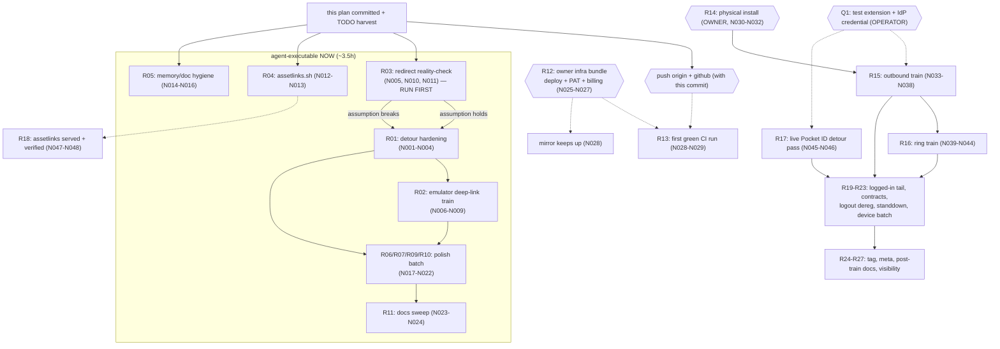

# SUPERB — Detour Hardening, Deep-Link Proof & Train Unblocks (2026-10-27 15:17)

> **EXECUTED 2026-10-28 (done at):** the entire agent wave — R01, R02,
> R03, R04, R05, R06, R07, R09, R10/R11 — shipped at the 94-test gate
> (0 failures, zipalign 16KB OK). R03's reality-check BUSTED the
> session-1 premise (server redirects ARE judged on modern Chromium);
> the detour fix rode the `isRedirect` seam and is on-device proven.
> R08, R12-R27 remain owner/credential-blocked as designed. Narrative:
> `docs/status/2026-10-28_00-20_r03-redirect-truth-and-deep-link-train-status.md`
>
> - CHANGELOG [Unreleased].

> **Basis:** `TODO_LIST.md` (17 rows, 15 BLOCKED owner/credential-gated),
> `ROADMAP.md` (raw ideas only), the prior plan
> `2026-10-25_10-17_SUPERB-post-hardening-verification-and-daily-driver-plan.md`
> (27 P-tasks, largely executed per its errata + the 14-33 report's strikes),
> and this session's reports: `docs/status/2026-10-27_15-11_deep-links-and-in-shell-oauth-status-and-self-review.md`
> (the auth-detour + deep-link session; gate green at 88 tests) and the
> pushes confirmed by the operator at 15:11.
>
> **Errata vs the 10-17 plan (do NOT re-dispatch):** P06 partial
> (W101-W103, W107, F024, F038, F058 verified; W104-W106 remain, folded
> into R20), P07 SHIPPED (ntfy kill-cycle proof, afternoon strike), P08
> diagnosed (billing block, no workflow defect), P09-P11 shipped except
> the tag itself, P13-P17 shipped (soak, UX tail, CallStyle fallback
> test, regression batch, swallow sweep + generation cleanup per the
> afternoon strike note), P19-P21 shipped, P23 docs-health pass shipped
> (06-27 report). Standing blockers unchanged: Q1 (test extension /
> IdP credential), T01 (deploy + PAT), billing, tag timing, KEEP-vs-PURGE.
> NEW since 10-17: the entire deep-link + auth-detour surface and its
> 8 follow-ups (R01-R09 below) from the 15-11 report.
>
> **ID convention:** this plan's coarse tasks are **R01-R27**, fine tasks
> **N001-N069**. Legacy P/F/W IDs stay where a task is a direct
> continuation (cited inline). `BLK` = operator/credential-gated.
> `Owner` = only the operator can execute. `READY` = agent-executable now.
>
> **Verschlimmbesserung guard:** every code task passes the gate
> (assembleDebug + 88 tests + zipalign + dprint) before it is done; no
> speculative rewrites (the detour policy is SHAPED — harden, never
> reshape); a fix that breaks the gate is reverted, not argued. The
> R01/R03 pair touches the auth path — smallest diffs that pin behavior,
> nothing more.

## Verification gate (every code task, unchanged from 10-17 + path fix)

```console
nix develop -c ./gradlew assembleDebug
nix develop -c ./gradlew testDebugUnitTest          # 88 tests must stay green
nix develop -c bash -c '"$ANDROID_HOME/build-tools/35.0.0/zipalign" -c -P 16 4 app/build/outputs/apk/debug/app-debug.apk'
nix run nixpkgs#dprint -- fmt                       # touched .md/.yml files
```

## Pareto breakdown

| Tier                     | Share                         | Delivers                                          | The tasks                                                                                                                                                                                                                    |
| ------------------------ | ----------------------------- | ------------------------------------------------- | ---------------------------------------------------------------------------------------------------------------------------------------------------------------------------------------------------------------------------- |
| **1% → 51%**             | ~3 of 27                      | The unblocked, PROVEN phone                       | Owner infra unblocks bundled (R12: deploy + PAT + billing), physical install (R15), outbound train (R16). Everything else polishes an unverified core — unchanged truth since 10-17.                                         |
| **4% → 64%**             | +5 (R01,R03,R17-R19)          | Truth about the NEW surfaces + the differentiator | Detour hardening (R01: retry-clear + onPageStarted belt), the redirect reality-check (R03 — the detour's ONE load-bearing assumption), the ring train (R17), live Pocket ID pass (R18), assetlinks served (R19).             |
| **20% → 80%**            | +10 (R02,R04,R05,R14,R20-R24) | Hardened by test + remaining gate rows            | Emulator deep-link train (R02), assetlinks.sh (R04), doc/memory hygiene (R05), first CI watch (R14), logged-in emulator tail (R20), live contracts (R21), logout dereg (R22), island standdown (R23), device verifies (R24). |
| **Remaining 20% → 100%** | +9 (R06-R11,R25-R27)          | Polish, named version, decided futures            | onNewIntent tests (R06), sip/tel URI edges (R07/R09), ROADMAP notes (R10), post-batch docs sweep (R11), tag + CHANGELOG cut (R25), repo meta (R26), post-train docs + visibility decision (R27).                             |

Sequencing: the agent tail (R01→R03→R02→R04→R05) runs NOW — R03 gates
nothing but RISK (it can invalidate the detour design; find out before
more detour-adjacent work). Owner rows fire whenever their unblock
lands; trains stay sequenced outbound → ring.

## Comprehensive plan — 27 tasks, 30–100 min each

Sorted by tier, then impact-to-effort. `BLK` = blocked on operator input
or a live stack. `Owner` = only the operator can execute.

| #       | Task                                                                                                                                                                                                                        | Tier     | Impact       | Effort          | Customer value                                                                                                             | Depends on      |
| ------- | --------------------------------------------------------------------------------------------------------------------------------------------------------------------------------------------------------------------------- | -------- | ------------ | --------------- | -------------------------------------------------------------------------------------------------------------------------- | --------------- |
| ~~R01~~ | ~~Detour hardening: `retry()` clears the auth detour + `onPageStarted` as second (idempotent) blessing hook + tests (15-11 report e1/e3)~~ done — 00-20 §a6-7 (retry clears + onPageStarted belt, unit-pinned)              | ~~4%~~   | ~~High~~     | ~~30min READY~~ | ~~The OIDC login path cannot hold a stale blessing or die on one hook~~                                                    | ~~—~~           |
| ~~R02~~ | ~~Emulator deep-link train: `am start` VIEW tel:/callto:/sip:/https (foreign + stack) → dialer prefill / shell path / home-state no-render~~ done — 00-20 §a8 (deep-link train, all rows, REAL resolver)                    | ~~20%~~  | ~~Med-High~~ | ~~30min READY~~ | ~~Deep links proven through the REAL intent-resolution stack, not Robolectric shadows~~                                    | ~~fresh APK~~   |
| ~~R03~~ | ~~Redirect reality-check: drive the REAL `/api/auth/oauth2/begin` link on the emulator, logcat-proof that the detour activates on a 302 commit~~ done — 00-20 §a1-3 (premise BUSTED; isRedirect seam fix + on-device proof) | ~~4%~~   | ~~High~~     | ~~60min READY~~ | ~~The detour's load-bearing assumption (doUpdateVisitedHistory fires for redirect commits on real Chromium) becomes FACT~~ | ~~~~            |
| ~~R04~~ | ~~`scripts/assetlinks.sh`: emit serve-ready `/.well-known/assetlinks.json` (debug keystore SHA256) for the webphone repo~~ done — 00-20 §a9 (assetlinks.sh, keystore discovery + apksigner cross-check)                     | ~~20%~~  | ~~Med~~      | ~~30min READY~~ | ~~The cross-repo step becomes copy-paste; no fingerprint archaeology~~                                                     | ~~—~~           |
| ~~R05~~ | ~~Memory/doc hygiene: AGENTS status header refresh (88 tests, new surfaces), zipalign full-path invocation, rg `-r` trap lesson~~ done — 00-20 §a10 (AGENTS header, zipalign path, rg trap, corrected detour gotcha)        | ~~20%~~  | ~~Med~~      | ~~30min READY~~ | ~~The next session starts from truth, not a stale header~~                                                                 | ~~—~~           |
| ~~R06~~ | ~~`onNewIntent` test coverage: make the delegate test-visible, pin `setIntent` + routing~~ done — 00-20 §a11 (onNewIntentDelegate seam + warm-intent pins)                                                                  | ~~tail~~ | ~~Low-Med~~  | ~~30min READY~~ | ~~The warm-link path is pinned, not inspection-only~~                                                                      | ~~—~~           |
| ~~R07~~ | ~~sip:/tel: URI edges: `;transport=`/`;phone-context=` user-part params, `postd=` pause digits — strip + tests~~ done — post-report (URI params stripped + DeepLinkTargetTest)                                              | ~~tail~~ | ~~Low~~      | ~~30min READY~~ | ~~Odd-but-legal dial links stop prefilling garbage~~                                                                       | ~~—~~           |
| R08     | In-shell dialable short-circuit: `tel:`/`callto:`/`sip:` links INSIDE island pages route straight to the dialer (no chooser bounce) **→ operator product question — ROADMAP Open questions (in-shell dialable links)**      | 20%      | Med          | 30min BLK       | Tap-to-call inside messages feels native — needs the product answer (g1)                                                   | operator answer |
| ~~R09~~ | ~~tel: link while a call is LIVE → route straight to `CallActivity` (single-call policy, one hop earlier than the dialer's guard)~~ done — post-report (live-call Dial link → CallActivity + test)                          | ~~tail~~ | ~~Low~~      | ~~30min READY~~ | ~~Mid-call dial links land on the call, not a dead dialer~~                                                                | ~~—~~           |
| ~~R10~~ | ~~ROADMAP additions: "OAuth outside the WebView" (Custom Tabs + app-link callback) raw idea; visibility/assetlinks interplay note~~ done — 00-20 f7 (ROADMAP raw ideas recorded)                                            | ~~tail~~ | ~~Low~~      | ~~30min READY~~ | ~~The long-term hardening path is written down before it is needed~~                                                       | ~~—~~           |
| ~~R11~~ | ~~Post-batch docs sweep: FEATURES/CHANGELOG flips for R01-R09, annotate this plan + the 15-11 report `done at`~~ done — N023 landed; N024 = THIS sweep (2026-10-28)                                                         | ~~tail~~ | ~~Med~~      | ~~30min READY~~ | ~~Docs match the shipped reality (docs-health ANNOTATE discipline)~~                                                       | ~~R01-R09~~     |
| R12     | Owner infra bundle: SystemNix deploy (attach push mirror) + PAT `repo`+`workflow` re-scope + GitHub billing fix (P01, three 10-min owner actions) **→ TODO_LIST (Owner bundle: deploy + PAT + billing, R12/N025-N027)**     | 1%       | Critical     | 35min Owner     | History flows automatically; domains unfreezes; CI jobs can start                                                          | —               |
| R13     | First green CI run: watch the next push fire, fix runner assumptions it exposes (P08/F041) **→ TODO_LIST (first green CI run, R13/N029 — after R12)**                                                                       | 20%      | High         | 12min BLK       | "Verified in CI" becomes TRUE for the first time                                                                           | R12             |
| R14     | Physical install + first-run walk of the current build (F005-F007) **→ TODO_LIST (First physical install, R14/N030-N032)**                                                                                                  | 1%       | Critical     | 30min Owner     | The actual phone runs the actual app                                                                                       | fresh APK       |
| R15     | Device train 1: outbound E2E against the live stack (F008-F014: session, REGISTER, INVITE ladder, audio, hangup) **→ TODO_LIST (outbound device train, R15/N033-N038 — Q1)**                                                | 1%       | Critical     | 100min BLK      | The core promise PROVEN                                                                                                    | Q1, R14         |
| R16     | Device train 2: ring-while-closed + answer-path race + call-screen visuals (F015-F020) **→ TODO_LIST (ring train + race + visuals, R16/N039-N044 — Q1)**                                                                    | 4%       | Critical     | 100min BLK      | The differentiator PROVEN; the race answered                                                                               | Q1, R15         |
| R17     | Live Pocket ID pass: login through the detour, cookie mints in the WebView jar, registration follows **→ TODO_LIST (live Pocket ID detour pass, R17/N045-N046 — credential)**                                               | 4%       | High         | 30min BLK       | SSO-in-app becomes a VERIFIED feature, not a pinned policy                                                                 | Q1-adjacent     |
| R18     | assetlinks.json served by webphone + `adb verify-app-links` green **→ TODO_LIST (assetlinks served + verified, R18/N047-N048 — owner)**                                                                                     | 4%       | Med-High     | 30min Owner     | Stack links open the app seamlessly (no chooser)                                                                           | R04             |
| R19     | Logged-in emulator tail: W104 attach, W105 external-link hand-off, W106 back-nav (the 10-17 leftovers) **→ TODO_LIST (logged-in emulator tail, R19/N049-N051 — credential)**                                                | 20%      | Med-High     | 30min BLK       | The WebView hardening batch gets its logged-in eyes                                                                        | credential      |
| R20     | Live contract checks folded into the trains: session fields, payload shapes, CSRF (T15) **→ TODO_LIST (Live contract checks, R20/N052-N053)**                                                                               | 20%      | Med          | 60min BLK       | The cross-repo seam verified against the real server                                                                       | R15             |
| R21     | Logout deregistration: KEEP-vs-PURGE answer → JS bridge or confirm cookie-poll (F045-F047) **→ TODO_LIST (Logout deregistration, R21/N054-N056)**                                                                           | 20%      | Med          | 60min BLK       | No ghost rows in the push registry after logout                                                                            | F045 answer     |
| R22     | Island-standdown seam: design note in webphone + wire end-to-end (owner nod first, P24) **→ TODO_LIST (island-standdown seam, R22/N057-N058 — owner nod)**                                                                  | 20%      | Med          | 100min BLK      | One registration owner; no ghost island REGISTER                                                                           | owner nod       |
| R23     | Device-verify batch: CallStyle post-time (F063), TalkBack walkthrough (F053), battery allow/deny (F052) **→ TODO_LIST (device-verify batch, R23/N059-N061)**                                                                | 20%      | Med          | 60min BLK       | Platform calling look + accessibility PROVEN on hardware                                                                   | R15/R16         |
| R24     | `v0.1.0` annotated tag + CHANGELOG cut (F074b/F089 — operator timing call) **→ TODO_LIST (v0.1.0 tag + CHANGELOG cut, R24/N062-N063 — operator)**                                                                           | tail     | Med          | 30min BLK       | A nameable version                                                                                                         | operator call   |
| R25     | Repo meta tail: Forgejo description (token), icon parity both-or-neither (F077/F079) **→ TODO_LIST (Forgejo description + icon parity, R25/N064-N065)**                                                                     | tail     | Low-Med      | 30min BLK       | The repo looks owned                                                                                                       | —               |
| R26     | Post-train docs sweep: honesty-marker retirement (F087), ROADMAP multi-line/provisioning revisit (F088) **→ TODO_LIST (post-train docs sweep, R26/N066-N068)**                                                              | tail     | Med          | 100min BLK      | README truth matches verified reality                                                                                      | R15/R16         |
| R27     | Visibility end-state: keep the GitHub twin private or flip public once the honesty markers clear (ROADMAP open question) **→ TODO_LIST / ROADMAP Open questions (visibility end-state, R27/N069)**                          | tail     | Low-Med      | 30min BLK       | The distribution story is decided, not drifting                                                                            | R26             |

**Totals:** ~23h across 27 tasks. Owner/credential-gated: 15 tasks
(~13h). Agent-executable RIGHT NOW: 10 tasks (~6h): R01-R07, R09-R11 —
and R03 should run FIRST among them (it can invalidate the detour
design; cheap insurance before more detour-adjacent polish).

## Fine breakdown — ≤ 12 min each

Sorted by parent task, tier order. Legacy IDs cited where a task
continues one. `BLK` = operator/live-stack gated.

| ID       | Task (≤12min)                                                                                                                                                              | Min    | Parent  |
| -------- | -------------------------------------------------------------------------------------------------------------------------------------------------------------------------- | ------ | ------- |
| ~~N001~~ | ~~Fix: `retry()` clears `authDetour` before reloading the origin~~ done — 00-20 §a6                                                                                        | ~~5~~  | ~~R01~~ |
| ~~N002~~ | ~~Test: offline Retry on a detoured page leaves no stale blessing~~ done — 00-20 §a6 (unit-pinned)                                                                         | ~~10~~ | ~~R01~~ |
| ~~N003~~ | ~~Harden: `onPageStarted` foreign main-frame start also blesses (idempotent; the belt to doUpdateVisitedHistory's suspenders)~~ done — 00-20 §a7                           | ~~12~~ | ~~R01~~ |
| ~~N004~~ | ~~Test: blessing survives via EITHER hook; origin commit still clears; gate run~~ done — either-hook blessing + origin-clear pinned                                        | ~~12~~ | ~~R01~~ |
| ~~N005~~ | ~~Add a detour-transition debug log (bless/clear, tag WebSurface) — diagnosability without a debugger~~ done — 00-20 §a5 (transition log produced the proof line)          | ~~5~~  | ~~R03~~ |
| ~~N006~~ | ~~Emulator up + fresh `assembleDebug` + install (`emulator-train.sh` discipline, one adb per session)~~ done — 00-20 §a8 (one-adb + adb-root discipline)                   | ~~12~~ | ~~R02~~ |
| ~~N007~~ | ~~`am start -a android.intent.action.VIEW -d "tel:+49…"` (adb root) → dialer prefill asserted + screenshot~~ done — 00-20 §a8 (tel via resolver → prefilled)               | ~~12~~ | ~~R02~~ |
| ~~N008~~ | ~~`am start -d "https://pbx.artmann.tech/messages"` → shell loads the path (no chooser); screenshot~~ done — 00-20 §a8 (stack https → shell path)                          | ~~12~~ | ~~R02~~ |
| ~~N009~~ | ~~`am start -d "sip:100@host"` / `callto:` variants → dialer; foreign https → home state, no render~~ done — 00-20 §a8 (sip/callto direct; foreign → home)                 | ~~12~~ | ~~R02~~ |
| ~~N010~~ | ~~R03 core: load the stack login in the shell, tap "Continue to Pocket ID", logcat-prove the detour blesses on the 302 commit~~ done — 00-20 §a1/3 (bless line in logcat)  | ~~12~~ | ~~R03~~ |
| ~~N011~~ | ~~R03 verdict: assumption holds → record `done at`; assumption breaks → fix the hook set + tests + report~~ done — 00-20 §a1-3 (assumption BROKEN → fixed + proven)        | ~~12~~ | ~~R03~~ |
| ~~N012~~ | ~~Write `scripts/assetlinks.sh` (keytool SHA256 of the debug keystore → assetlinks.json to stdout)~~ done — 00-20 §a9                                                      | ~~12~~ | ~~R04~~ |
| ~~N013~~ | ~~Test-run the script; wire its output into the TODO row's hand-off note~~ done — 00-20 §a9 (signature match pm get-app-links)                                             | ~~10~~ | ~~R04~~ |
| ~~N014~~ | ~~AGENTS.md status header: 88 tests, deep links + auth detour shipped, CI-never-ran still true~~ done — 00-20 §a10                                                         | ~~10~~ | ~~R05~~ |
| ~~N015~~ | ~~AGENTS.md build section: the full zipalign path invocation (build-tools 35)~~ done — 00-20 §a10 (now build-tools 36 after the jump)                                      | ~~5~~  | ~~R05~~ |
| ~~N016~~ | ~~AGENTS.md gotcha: the rg `-r` replace-display trap (third strike 2026-10-27; `-n` is the recursive search)~~ done — 00-20 §a10 (rg trap gotcha)                          | ~~10~~ | ~~R05~~ |
| ~~N017~~ | ~~Make `onNewIntent`'s delegate test-visible (`@VisibleForTesting` seam, no behavior change)~~ done — 00-20 §a11                                                           | ~~12~~ | ~~R06~~ |
| ~~N018~~ | ~~Test: warm VIEW intent → setIntent + routing pinned end-to-end~~ done — 00-20 §a11 (setIntent + routing pinned)                                                          | ~~12~~ | ~~R06~~ |
| ~~N019~~ | ~~sip: user-part params (`;transport=`, `;phone-context=`) stripped + tests~~ done — post-report (sip params stripped)                                                     | ~~12~~ | ~~R07~~ |
| ~~N020~~ | ~~tel: `postd=`/`isub=` extras stripped + tests (RFC 3966)~~ done — post-report (postd/isub stripped)                                                                      | ~~10~~ | ~~R07~~ |
| ~~N021~~ | ~~Route: a Dial deep link while a call is live → `CallActivity` directly (code + test)~~ done — post-report (live-call route + test)                                       | ~~12~~ | ~~R09~~ |
| ~~N022~~ | ~~ROADMAP: "OAuth outside the WebView" raw idea + assetlinks/visibility interplay note~~ done — ROADMAP Auth theme raw ideas                                               | ~~10~~ | ~~R10~~ |
| ~~N023~~ | ~~Docs sweep: FEATURES/CHANGELOG flips for everything R01-R09 shipped~~ done — CHANGELOG/FEATURES flips landed                                                             | ~~12~~ | ~~R11~~ |
| ~~N024~~ | ~~Annotate this plan + the 15-11 report with `done at` markers (docs-health ANNOTATE)~~ done — THIS sweep (2026-10-28): the 15-17 plan + 15-11 report annotated row-by-row | ~~10~~ | ~~R11~~ |
| N025     | Owner: SystemNix deploy (`nix run .#deploy`) — phase 5 attaches the push mirror (T01a) **→ TODO_LIST (Owner: SystemNix deploy, R12)**                                      | 10     | R12     |
| N026     | Owner: regenerate sync PAT `repo`+`workflow` scope, sops update, redeploy (T01b) **→ TODO_LIST (Owner: PAT repo+workflow, R12)**                                           | 15     | R12     |
| N027     | Owner: GitHub billing fix (payment/spending limit) (P08) **→ TODO_LIST (Owner: GitHub billing fix, R12)**                                                                  | 10     | R12     |
| N028     | Verify: mirror keeps up (`scripts/mirror-lag.sh`) after the deploy (F003) **→ TODO_LIST (mirror-lag verify, R12)**                                                         | 10     | R12     |
| N029     | Watch the first green CI run; fix what it exposes (F041) **→ TODO_LIST (first green CI run, R13)**                                                                         | 12     | R13     |
| N030     | Rebuild fresh APK; never trust a stale artifact (F005) **→ TODO_LIST (fresh APK, R14)**                                                                                    | 10     | R14     |
| N031     | `adb install -r` onto the phone; grant mic + notifications (F006) **→ TODO_LIST (adb install + grants, R14)**                                                              | 10     | R14     |
| N032     | First-run walk: origin, island login, badge REGISTERED, battery Unrestricted (F007) **→ TODO_LIST (first-run walk, R14)**                                                  | 10     | R14     |
| N033     | Collect stack facts: test extension, account, `/api/session` shape (F008) **→ TODO_LIST (Q1 stack facts, R15)**                                                            | 10     | R15     |
| N034     | Verify island login mints the cookie; `/api/session` returns SIP facts (F009) **→ TODO_LIST (cookie + session resume, R15)**                                               | 10     | R15     |
| N035     | Verify REGISTER digest challenge → 200 in logs (F010) **→ TODO_LIST (REGISTER → 200, R15)**                                                                                | 10     | R15     |
| N036     | Dial echo extension; INVITE/180/200/ACK ladder (+401 ladder if challenged) (F011) **→ TODO_LIST (INVITE ladder, R15)**                                                     | 12     | R15     |
| N037     | Two-way audio + mute + AEC/NS engages (F012, folds F081) **→ TODO_LIST (audio + AEC/NS, R15)**                                                                             | 12     | R15     |
| N038     | Hang up: CANCEL/BYE path, teardown, FGS stop; FreeSWITCH CANCEL-on-give-up (F013, folds F084) **→ TODO_LIST (hangup + FreeSWITCH CANCEL, R15/R16)**                        | 12     | R15     |
| N039     | `/api/push-devices` rows exist for both lanes (F015, folds F048-F050) **→ TODO_LIST (push-device rows, R16)**                                                              | 10     | R16     |
| N040     | Kill the app; trigger inbound from the second extension (F016) **→ TODO_LIST (inbound trigger, R16)**                                                                      | 10     | R16     |
| N041     | FSI + Telecom ring; measure the bootstrap race (F017) **→ TODO_LIST (FSI ring + race, R16)**                                                                               | 12     | R16     |
| N042     | Answer via tap; 200 OK + audio; then via BT/watch (F018) **→ TODO_LIST (tap + BT/watch answers, R16)**                                                                     | 12     | R16     |
| N043     | `ring_end` stands down; decline sends 603; ring_end-after-answer no-ops on device (F019) **→ TODO_LIST (ring_end + 603 no-ops, R16)**                                      | 10     | R16     |
| N044     | Screenshots: call ringing/active/ended (F020) **→ TODO_LIST (call screenshots, R16)**                                                                                      | 12     | R16     |
| N045     | Live Pocket ID: complete the login in-shell through the detour (R17 core) **→ TODO_LIST (live Pocket ID login, R17)**                                                      | 12     | R17     |
| N046     | Assert: session cookie in the WEBVIEW jar (not Chrome), registration follows **→ TODO_LIST (cookie-in-jar assert, R17)**                                                   | 10     | R17     |
| N047     | Owner: run `scripts/assetlinks.sh`, commit the JSON to webphone's served path **→ TODO_LIST (assetlinks JSON to webphone, R18)**                                           | 12     | R18     |
| N048     | `adb verify-app-links --re-verify` + Settings "open by default" green **→ TODO_LIST (verify-app-links green, R18)**                                                        | 10     | R18     |
| N049     | Logged-in emulator: composer attach → picker → send (W104) **→ TODO_LIST (W104 attach, R19)**                                                                              | 12     | R19     |
| N050     | Logged-in emulator: external link hand-off, NOT in-shell (W105) **→ TODO_LIST (W105 hand-off, R19)**                                                                       | 10     | R19     |
| N051     | Logged-in emulator: tab-nav back stack + `canGoBack` boundary (W106) **→ TODO_LIST (W106 back stack, R19)**                                                                | 10     | R19     |
| N052     | Live contracts: session fields + push payload shapes vs the server repo (T15a) **→ TODO_LIST (session + payload contracts, R20)**                                          | 12     | R20     |
| N053     | Live contracts: CSRF dance on a real device-boot (T15b) **→ TODO_LIST (CSRF dance, R20)**                                                                                  | 12     | R20     |
| N054     | Owner: KEEP-vs-PURGE answer for `/api/push-devices` on logout (F045) **→ TODO_LIST (KEEP-vs-PURGE answer, R21)**                                                           | 5      | R21     |
| N055     | Implement the chosen path (JS-bridge deregister or confirm cookie-poll) (F046) **→ TODO_LIST (implement chosen path, R21)**                                                | 12     | R21     |
| N056     | Verify server-side row removal on island logout (F047) **→ TODO_LIST (row-removal verify, R21)**                                                                           | 10     | R21     |
| N057     | Design note in webphone: "native shell present" signal (W195) **→ TODO_LIST (standdown design note, R22)**                                                                 | 12     | R22     |
| N058     | Wire the signal end-to-end once approved (W196) **→ TODO_LIST (wire the signal, R22)**                                                                                     | 12     | R22     |
| N059     | Device: CallStyle post-time verify (F063) **→ TODO_LIST (CallStyle post-time verify, R23)**                                                                                | 10     | R23     |
| N060     | Device: TalkBack walkthrough (F053) **→ TODO_LIST (TalkBack walkthrough, R23)**                                                                                            | 12     | R23     |
| N061     | Device: battery-prompt allow/deny (F052) **→ TODO_LIST (battery allow/deny, R23)**                                                                                         | 12     | R23     |
| N062     | Owner: tag timing call + `v0.1.0` annotated tag (F074b) **→ TODO_LIST (v0.1.0 tag, R24 — operator)**                                                                       | 10     | R24     |
| N063     | CHANGELOG cut for the version (F089) **→ TODO_LIST (CHANGELOG cut, R24)**                                                                                                  | 10     | R24     |
| N064     | Forgejo repo description (F077, BLK token) **→ TODO_LIST (Forgejo description, R25)**                                                                                      | 10     | R25     |
| N065     | Icon parity both-or-neither with webphone (F079, BLK owner) **→ TODO_LIST (icon parity, R25)**                                                                             | 12     | R25     |
| N066     | Retire honesty markers the trains prove (F087) **→ TODO_LIST (honesty retirement, R26)**                                                                                   | 12     | R26     |
| N067     | ROADMAP revisit: multi-line, provisioning (F088) **→ TODO_LIST (ROADMAP revisit, R26)**                                                                                    | 10     | R26     |
| N068     | CHANGELOG cut for the NEXT version post-trains (F089b) **→ TODO_LIST (next-version CHANGELOG cut, R26)**                                                                   | 10     | R26     |
| N069     | Visibility decision: private vs public flip once markers clear (owner) **→ TODO_LIST / ROADMAP Open questions (visibility, R27)**                                          | 10     | R27     |

**Totals:** 69 fine tasks, ~11.5h. Agent-executable NOW: N001-N024
(~3.5h). Owner/credential-gated: 45 tasks (~8h), of which the five
10-15min owner actions in R12 are the single highest-leverage unlock on
the board.

## Execution graph



## Harvest note (executed with this plan)

`TODO_LIST.md` gains a **Ready (agent-executable)** section carrying
R01-R07/R09/R10/R11 as rows (evidence: this plan + the 15-11 report §e/f);
the 15 existing BLOCKED rows are re-parented to R-IDs. No row was
duplicated; legacy P/F/W citations preserved.

## Questions standing (from the 15-11 report, unchanged)

1. In-shell dialable links: straight to the native dialer, or keep
   browser-parity hand-off? (gates R08)
2. assetlinks key: debug-cert SHA256 now (per-machine) or wait for a
   release signing config? (shapes R18)
3. Pocket ID deployment: one authority for ALL IdP assets, or
   multi-host? (a multi-host IdP needs a different detour allowance)
