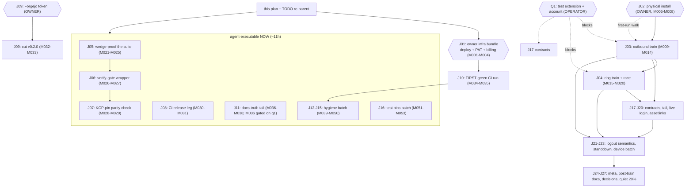

# SUPERB — Post-Archive Unblock & Train Plan (2026-10-28 02:56)

> **Basis:** the rebuilt `TODO_LIST.md` (17-row Ready refill + 22 BLOCKED rows,
> 2026-10-28 ~02:40), the annotated + ARCHIVED corpus
> (`docs/status/archived/`, `docs/planning/archived/` — ≈990 verdicts, every
> R-/N-/P-/F-ID now a stable label into closed history), the status report
> `docs/status/2026-10-28_02-49_docs-health-mega-sweep-corpus-annotated-and-archived.md`,
> and the LIVE sibling release-lane session (`scripts/release.sh`,
> `scripts/forgejo-release.py`, the Obtainium rows — hot files, not ours).
> **Nothing in this plan re-dispatches shipped work.**
>
> **ID convention:** coarse tasks **J01-J27**, fine tasks **M001-M099**.
> Legacy IDs (R/N/P/F) are cited inline as provenance only. `BLK` =
> operator/credential/live-stack gated. `Owner` = only the operator can
> execute. `nod` = waits on a written operator answer (this plan's §g).
>
> **Standing blockers (owner):**
>
> - **Q1:** test extension (+ account) for `pbx.artmann.tech` — gates both
>   device trains, the contracts, and the logged-in emulator tail.
> - **J01 bundle:** SystemNix deploy (mirror attach), sync PAT
>   `repo`+`workflow` re-scope, GitHub Actions billing — three ~10-minute
>   owner actions that unblock history flow + the first green CI run.
> - **Credentials:** Forgejo token with `write:repository` (release cut),
>   Pocket ID test identity (live login), the operator's phone (install).
> - **Decisions:** logout KEEP-vs-PURGE (F045), in-shell dialable links
>   (R08), island-standdown nod (P24), visibility end-state (R27), and this
>   plan's own §g (archive evidence-prefixing, sibling-report annotation,
>   AGENTS slimming).
>
> **Verschlimmbesserung guard:** every code task passes the gate
> (`assembleDebug` + `testDebugUnitTest` + `ktlintCheck` + 16 KB zipalign)
> before it is done; `scripts/contrast-check.py` after ANY token change; no
> speculative rewrites (the auth detour is SHAPED — harden, never reshape;
> AGENTS.md slims by pointer, never by deleting a gotcha); the archive is
> CLOSED — annotate new reports at session end instead of re-sweeping; the
> sibling's release-lane files (`scripts/release.sh`, `forgejo-release.py`,
> README release sections) are claimed by a live session — this plan queues
> around them, never through them. A fix that breaks the gate is reverted,
> not argued.
>
> **Sequencing rule:** the 1% never waits on the tail. Owner rows fire on
> their own clock; the agent track runs J05→J06→J07 now (they harden the
> gate every later task stands on); the release cut (J09) ships the moment
> its token exists; trains fire the moment Q1 lands — outbound before ring.

## Pareto breakdown

| Tier                     | Share of work  | Delivers                                   | The tasks                                                                                                                                                                                                            |
| ------------------------ | -------------- | ------------------------------------------ | -------------------------------------------------------------------------------------------------------------------------------------------------------------------------------------------------------------------- |
| **1% → 51%**             | ~4 tasks of 27 | The app PROVEN on a real phone             | The owner infra bundle (J01), the physical install (J02), and the TWO DEVICE TRAINS (J03/J04). Until these run, every other line polishes an unverified core — the standing truth since the first plan (2026-10-24). |
| **4% → 64%**             | +7 (J05-J11)   | A gate you can trust + a shippable version | Wedge-proof the suite (J05), the one-command gate (J06), KGP-pin parity mechanized (J07), CI release leg (J08), the FIRST release cut (J09), the first green CI run (J10), and the docs-truth tail (J11).            |
| **20% → 80%**            | +11 (J12-J22)  | Hardened, verified, daily-driver credible  | Hygiene batch (J12-J15), then the live-stack verifications: contracts (J16), logged-in tail (J17), live login (J18), assetlinks (J19), logout semantics (J20), standdown seam (J21), device-verify batch (J22).      |
| **Remaining 20% → 100%** | +5 (J23-J27)   | Owned repo, decided futures, quiet system  | Repo meta (J23), post-train docs (J24), decisions sweep (J25), archive hygiene (J26), and the future-proof tail (J27).                                                                                               |

Totals: ~27h across 27 tasks. Owner/credential/BLK-gated: 15 tasks (~14h).
Agent-executable RIGHT NOW: 12 tasks (~11h) — J05-J08, J11-J15, plus J26's
ungated half.

## Comprehensive plan — 27 tasks, 30-100 min each

Sorted by tier, then impact-to-effort. Every row carries its provenance
(archived IDs) and its gate.

| #   | Task                                                                                                                                                                                                                            | Tier | Impact   | Effort       | Customer value                                                             | Depends on      |
| --- | ------------------------------------------------------------------------------------------------------------------------------------------------------------------------------------------------------------------------------- | ---- | -------- | ------------ | -------------------------------------------------------------------------- | --------------- |
| J01 | Owner infra bundle: SystemNix deploy (attach push mirror) + PAT `repo`+`workflow` re-scope + GitHub billing fix (R12/N025-N027)                                                                                                 | 1%   | Critical | 35min Owner  | History flows automatically; domains unfreezes; CI jobs can start          | —               |
| J02 | First physical install + first-run walk of the current build (R14/N030-N032) + Obtainium update-channel setup (M008, after J09)                                                                                                 | 1%   | Critical | 45min Owner  | The actual phone runs the actual app, then keeps itself updated            | fresh APK       |
| J03 | Device train 1: outbound E2E — login, REGISTER, INVITE ladder, audio, hang-up (R15/N033-N038)                                                                                                                                   | 1%   | Critical | 100min BLK   | The core promise PROVEN                                                    | Q1, J02         |
| J04 | Device train 2: ring-while-closed + answer-path race + call-screen visuals (R16/N039-N044)                                                                                                                                      | 1%   | Critical | 100min BLK   | The differentiator PROVEN; the race answered; the unseen surface SEEN      | Q1, J03         |
| J05 | Wedge-proof the JVM suite: task-level fence + per-test timeouts + `forkEvery`/fresh-executor + shared OkHttp dispatcher                                                                                                         | 4%   | High     | 100min       | A future wedge dies in minutes, not 5h28m                                  | —               |
| J06 | `scripts/verify-gate.sh` (or flake app): pre-flight gradle → build → test → zipalign → contrast → dprint, one command                                                                                                           | 4%   | High     | 45min        | The gate becomes one command and one background job                        | —               |
| J07 | Mechanize the KGP-pin ↔ catalog version parity (check task fails the build on drift)                                                                                                                                            | 4%   | Med-High | 30min        | The doc-only invariant stops rotting silently                              | —               |
| J08 | CI: add `assembleRelease` to the verify job + artifact the R8 `mapping.txt`                                                                                                                                                     | 4%   | Med-High | 30min        | R8 exercised in CI; retrace becomes possible later                         | —               |
| J09 | Cut the first release (`v0.2.0`) via `scripts/release.sh` (gate → sign → tag → push → publish)                                                                                                                                  | 4%   | Critical | 15min Owner  | The phone can update itself; the version becomes nameable                  | Forgejo token   |
| J10 | Watch the FIRST green CI run; fix the runner assumptions it exposes (R13/N029)                                                                                                                                                  | 4%   | High     | 20min BLK    | "Verified in CI" becomes TRUE for the first time                           | J01 (billing)   |
| J11 | Docs-truth tail: normalize archived evidence-path prefixes (g1) + fix the two wrong-actor verdicts + one full gradle gate                                                                                                       | 4%   | Med      | 45min        | The archive's cites resolve byte-honest; the gate covers the docs sweep    | g1 (half)       |
| J12 | Dependabot config audit (ktlint plugin entry; removed kotlin-android/okhttp-ws aliases)                                                                                                                                         | 20%  | Med      | 15min        | Dependency automation keeps mapping the catalog                            | —               |
| J13 | Gradle hygiene batch: `--warning-mode all` sweep + `build/reports/problems/` (kill the Gradle-10 deprecation source) + version-catalog update-plugin evaluation + build-cache evaluation                                        | 20%  | Med      | 60min        | The next toolchain jump starts from silence; two hand-run matrices retired | —               |
| J14 | Suppress-or-migrate the 4 compileSdk-37 deprecations (FcmReceiver 2-liner; Telecom + onBackPressed need recorded decisions)                                                                                                     | 20%  | Med      | 30min        | Warnings are signal again                                                  | —               |
| J15 | Micro-investigations batch: dialpad-"100" (blank-vs-seeded) + viewbinding-on-classpath + gate hygiene (ktlintKotlinScriptFormat, dprint/ktlint boundary) + the cross-repo 302-note + the detour CANCEL-leg re-run (uiautomator) | 20%  | Med      | 60min        | Five small unknowns closed; one cross-repo landmine flagged                | —               |
| J16 | Test pins batch: ntfy ACTION_STOP stopped-flag case + `wiringEnabled` gate semantics + one Robolectric SDK policy                                                                                                               | 20%  | Med      | 60min        | The stop-leak and the hermeticity gate are pinned, not inspection-only     | —               |
| J17 | Live contract checks: `/api/session` fields, payload shapes, CSRF dance (R20/N052-N053)                                                                                                                                         | 20%  | Med      | 60min BLK    | The cross-repo seam verified against the real server                       | Q1              |
| J18 | Logged-in emulator tail: W104 attach, W105 hand-off vs the redirect seam, W106 back stack (R19/N049-N051)                                                                                                                       | 20%  | Med      | 30min BLK    | The WebView hardening batch gets its logged-in eyes                        | Pocket ID cred. |
| J19 | Live Pocket ID detour pass: login IN-SHELL, cookie mints in the WebView jar (R17/N045-N046)                                                                                                                                     | 20%  | High     | 30min BLK    | SSO-in-app becomes a VERIFIED feature                                      | Pocket ID cred. |
| J20 | assetlinks.json served by the stack + `adb verify-app-links` green (R18/N047-N048)                                                                                                                                              | 20%  | Med-High | 30min Owner  | Stack links open the app seamlessly (no chooser)                           | J01 optional    |
| J21 | Logout deregistration: KEEP-vs-PURGE answer → implement JS bridge or confirm cookie-poll (R21/N054-N056)                                                                                                                        | 20%  | Med      | 60min BLK    | No ghost rows in the push registry after logout                            | F045 answer     |
| J22 | Island-standdown seam: design note + wire end-to-end (R22/N057-N058)                                                                                                                                                            | 20%  | Med      | 100min BLK   | One registration owner; no ghost island REGISTER                           | owner nod       |
| J23 | Device-verify batch: CallStyle post-time, TalkBack walkthrough, battery allow/deny (R23/N059-N061)                                                                                                                              | 20%  | Med      | 60min BLK    | Platform calling look + accessibility PROVEN on hardware                   | J03/J04         |
| J24 | Repo meta tail: Forgejo description (token) + icon parity both-or-neither (R25/N064-N065)                                                                                                                                       | tail | Low-Med  | 30min BLK    | The repo looks owned                                                       | token / nod     |
| J25 | Post-train docs sweep: honesty-marker retirement + next CHANGELOG cut (R26/N066-N068)                                                                                                                                           | tail | Med      | 100min BLK   | README truth matches verified reality                                      | J03/J04         |
| J26 | Decisions sweep: the 8 ROADMAP Open questions + visibility end-state (R27/N069) — each answer becomes work or a non-goal                                                                                                        | tail | Med      | 45min Owner  | No drift between head and repo                                             | operator        |
| J27 | Future-proof tail: annotate+archive the sibling's 3 reports (g2), AGENTS slim-down <30 KB (g3), targetSdk 37 (train-gated), API 37 image, mockwebserver3                                                                        | tail | Low-Med  | 100min gated | The quiet 20%: nothing stale, nothing behind                               | g2/g3/trains    |

**Agent-executable RIGHT NOW:** J05, J06, J07, J08, J11 (half), J12, J13,
J14, J15, J16 ≈ 11h. **The single highest-leverage unlock:** J01 (three
owner 10-minute actions) — it unblocks J10, halves J20's friction, and
starts the mirror keeping history safe.

## Fine breakdown — ≤ 12 min each (ALL todos)

`BLK` rows need operator input, a credential, the phone, or a live stack.
Legacy IDs cited as provenance. Sorted by parent, tier order.

<!-- check-rows:ledger -->

| ID   | Task (≤12min)                                                                                                                                                                           | Parent |
| ---- | --------------------------------------------------------------------------------------------------------------------------------------------------------------------------------------- | ------ |
| M001 | Owner: `cd ~/projects/SystemNix && nix run .#deploy` — phase 5 attaches the push mirror (N025)                                                                                          | J01    |
| M002 | Owner: regenerate sync PAT `repo`+`workflow` at GitHub, update the sops secret, redeploy (N026)                                                                                         | J01    |
| M003 | Owner: GitHub Billing & plans — fix the failed payment / spending limit (N027)                                                                                                          | J01    |
| M004 | Verify the mirror keeps up: `scripts/mirror-lag.sh` after the deploy (N028)                                                                                                             | J01    |
| M005 | Owner: rebuild fresh (`assembleDebug`), never trust a stale APK (F005/N030)                                                                                                             | J02    |
| M006 | Owner: `adb install -r` the debug (or signed release) APK; grant mic + notifications (F006/N031)                                                                                        | J02    |
| M007 | Owner: first-run walk — origin check, island login, badge REGISTERED, battery Unrestricted (F007/N032)                                                                                  | J02    |
| M008 | Owner/device: connect the phone to Obtainium — private-repo token, per-app "Allow insecure HTTP requests" (internal dnsblockd CA), uninstall the debug build first; needs J09's release | J02    |
| M009 | BLK/Q1: collect stack facts — test extension, account, `/api/session` shape (F008/N033)                                                                                                 | J03    |
| M010 | BLK/Q1: verify island login mints the cookie; `/api/session` returns SIP facts (F009/N034)                                                                                              | J03    |
| M011 | BLK/Q1: REGISTER digest challenge → 200 in logs (F010/N035)                                                                                                                             | J03    |
| M012 | BLK/Q1: dial echo extension; INVITE/180/200/ACK ladder incl. the 401 rung (F011/N036)                                                                                                   | J03    |
| M013 | BLK/Q1: two-way audio + mute + AEC/NS engages (F012/N037)                                                                                                                               | J03    |
| M014 | BLK/Q1: hang up — CANCEL/BYE path, teardown, FGS stop; FreeSWITCH CANCEL-on-give-up (F013/N038)                                                                                         | J03    |
| M015 | BLK/Q1: verify `/api/push-devices` rows exist for both lanes (F015/N039)                                                                                                                | J04    |
| M016 | BLK/Q1: kill the app; trigger inbound from the second extension (F016/N040)                                                                                                             | J04    |
| M017 | BLK/Q1: FSI + Telecom ring; MEASURE the bootstrap race (push → FSI vs INVITE) (F017/N041)                                                                                               | J04    |
| M018 | BLK/Q1: answer via explicit tap; 200 OK + audio; then via BT/watch (F018/N042)                                                                                                          | J04    |
| M019 | BLK/Q1: `ring_end` stands down everywhere; decline sends 603; ring_end-after-answer no-ops (F019/N043)                                                                                  | J04    |
| M020 | BLK/Q1: screenshots — call ringing/active/ended (the never-SEEN surface) (F020/N044)                                                                                                    | J04    |
| M021 | Add the task-level fence to `testDebugUnitTest` (timeout / fail-on-hang)                                                                                                                | J05    |
| M022 | Add per-test timeouts (JUnit) for the MockWebServer/WebSocket-ish suites                                                                                                                | J05    |
| M023 | Add `forkEvery`/fresh-executor policy to bound cross-class static leakage                                                                                                               | J05    |
| M024 | Shared test OkHttp dispatcher with idle timeout; migrate the test sockets onto it                                                                                                       | J05    |
| M025 | Gate run: 94+ tests green with the fence armed (prove the wedge now dies loudly)                                                                                                        | J05    |
| M026 | Write `scripts/verify-gate.sh`: pre-flight `pgrep -f gradle` → build → test → zipalign → contrast → dprint                                                                              | J06    |
| M027 | Wire the wrapper into AGENTS "Build and verify" + run it once end-to-end                                                                                                                | J06    |
| M028 | Write the parity check task: compare the buildscript KGP literal vs the catalog `kotlin` version; fail on drift                                                                         | J07    |
| M029 | Prove it: bump one side in a scratch build, watch it fail, revert                                                                                                                       | J07    |
| M030 | CI: add `assembleRelease` to the verify job                                                                                                                                             | J08    |
| M031 | CI: artifact `app/build/outputs/mapping/release/mapping.txt` on release builds                                                                                                          | J08    |
| M032 | Owner: Forgejo token with `write:repository` → `release.sh --doctor` green                                                                                                              | J09    |
| M033 | Owner: cut v0.2.0 — `release.sh bump` + full publish (the sibling's lane; do not edit their scripts)                                                                                    | J09    |
| M034 | BLK/billing: watch the first green CI run end-to-end; capture the log (N029)                                                                                                            | J10    |
| M035 | Fix whatever the runner exposes (python3 availability, dprint via nix, build-tools path)                                                                                                | J10    |
| M036 | Normalize evidence-path prefixes inside the 21 archived files to `archived/` (g1 answer required)                                                                                       | J11    |
| M037 | Fix the two wrong-actor verdicts (00-25 f40, 01-35 c7 → credit the release-lane session)                                                                                                | J11    |
| M038 | One full gradle gate over the post-sweep tree (belt-and-suspenders for the 29-path docs change)                                                                                         | J11    |
| M039 | Dependabot audit: confirm the catalog reshaping still maps (plugin entry + removed aliases)                                                                                             | J12    |
| M040 | `--warning-mode all` gate run; capture the warning inventory                                                                                                                            | J13    |
| M041 | Read `build/reports/problems/`; identify + kill the Gradle-10 deprecation source                                                                                                        | J13    |
| M042 | Evaluate the Gradle version-catalog update plugin (retire the hand-run version matrices); adopt or record the non-goal                                                                  | J13    |
| M043 | Evaluate Gradle build-cache (45-96 task runs per gate; hits are incidental); adopt config or record the non-goal                                                                        | J13    |
| M044 | FcmReceiver: add the `@Deprecated`-safe annotation (2-line fix) or migrate                                                                                                              | J14    |
| M045 | Telecom `CAPABILITY_SELF_MANAGED` + `onBackPressed`: record the keep-decisions in AGENTS (or annotate-and-suppress)                                                                     | J14    |
| M046 | Investigate the dialpad default "100" display (FAB, no extra); decide blank-vs-seeded + implement                                                                                       | J15    |
| M047 | Investigate `androidx.databinding:viewbinding:9.4.1` on the unit-test classpath; confirm harmless or exclude                                                                            | J15    |
| M048 | Verify `ktlintKotlinScriptFormat` stays empty; confirm dprint never touches `.kt` (boundary check)                                                                                      | J15    |
| M049 | Cross-repo note (webphone issue/comment): the OIDC `begin`→IdP hop MUST stay a server 302                                                                                               | J15    |
| M050 | Emulator: re-run the detour CANCEL leg with `uiautomator` coordinates — consent Cancel → IdP error redirect → origin commit → detour cleared in logcat                                  | J15    |
| M051 | Pin the ntfy ACTION_STOP → stopped-flag case in `NtfySubscriptionServiceTest`                                                                                                           | J16    |
| M052 | Pin `wiringEnabled` gate semantics in a test (default true, per-class sandbox, no leak) + review AttachGuardTest                                                                        | J16    |
| M053 | Write the one Robolectric SDK policy; replace the scattered `@Config(sdk=[34])`                                                                                                         | J16    |
| M054 | BLK/Q1: verify session field names live (`sip_domain` vs camelCase) (F048/N052)                                                                                                         | J17    |
| M055 | BLK/Q1: verify push payload shapes on both lanes (F049/N052)                                                                                                                            | J17    |
| M056 | BLK/Q1: verify the CSRF dance on `/api/push-devices` POST/DELETE (F050/N053)                                                                                                            | J17    |
| M057 | BLK/cred: logged-in W104 — composer attach → picker → send (N049)                                                                                                                       | J18    |
| M058 | BLK/cred: logged-in W105 — external-link hand-off (re-verify against the redirect seam) (N050)                                                                                          | J18    |
| M059 | BLK/cred: logged-in W106 — tab-nav back stack + `canGoBack` boundary (N051)                                                                                                             | J18    |
| M060 | BLK/cred: live Pocket ID login IN-SHELL through the detour (N045)                                                                                                                       | J19    |
| M061 | BLK/cred: assert the session cookie mints in the WEBVIEW jar; registration follows (N046)                                                                                               | J19    |
| M062 | BLK/cred: re-verify `retry()`-clear + the belt against the REAL logged-in flow                                                                                                          | J19    |
| M063 | Owner: run `scripts/assetlinks.sh`, commit the JSON to webphone's served path (N047)                                                                                                    | J20    |
| M064 | `adb verify-app-links --re-verify` + Settings "open by default" green (N048)                                                                                                            | J20    |
| M065 | Owner: KEEP-vs-PURGE answer for `/api/push-devices` on logout (F045/N054)                                                                                                               | J21    |
| M066 | Implement the chosen path (JS-bridge deregister, or confirm cookie-poll) (F046/N055)                                                                                                    | J21    |
| M067 | Verify server-side row removal on island logout (F047/N056)                                                                                                                             | J21    |
| M068 | Design note in webphone: "native shell present" signal (W195/N057)                                                                                                                      | J22    |
| M069 | Wire the signal end-to-end once approved (W196/N058)                                                                                                                                    | J22    |
| M070 | Cross-repo (webphone's call): island `safe-area-inset-top` fix — the web header renders under the status bar in-shell; top controls untappable (W01/W102)                               | J22    |
| M071 | BLK/trains: CallStyle post-time verification on hardware (F063/N059)                                                                                                                    | J23    |
| M072 | BLK/trains: TalkBack walkthrough (dialpad, in-call, settings, shell, overlay) (F053/N060)                                                                                               | J23    |
| M073 | BLK/trains: battery-prompt allow/deny paths (F052/N061)                                                                                                                                 | J23    |
| M074 | BLK/token: set the Forgejo repo description (F077/N064)                                                                                                                                 | J24    |
| M075 | Owner: icon parity both-or-neither with the PWA (F079/N065)                                                                                                                             | J24    |
| M076 | BLK/trains: retire the honesty-contract markers the trains prove (F087/N066)                                                                                                            | J25    |
| M077 | BLK/trains: ROADMAP revisit — multi-line, provisioning (F088/N067)                                                                                                                      | J25    |
| M078 | CHANGELOG cut for the version after v0.2.0 (F089/N068)                                                                                                                                  | J25    |
| M079 | Owner: answer the 8 ROADMAP Open questions (Q1 extension; logout semantics; icon parity; visibility; R08 dialable links; IdP cancel target; crush-daily policy; concurrency policy)     | J26    |
| M080 | Owner: visibility end-state — flip the GitHub twin public or stay private (R27/N069)                                                                                                    | J26    |
| M081 | g2: annotate + archive the sibling's 3 live reports (01-36, 02-03, 02-23) once their session ends                                                                                       | J27    |
| M082 | g3: AGENTS.md slim-down — dedupe the decision block into ROADMAP pointers; target <30 KB, zero gotchas lost                                                                             | J27    |
| M083 | BLK/trains: targetSdk 36 → 37 bump + Android 17 behavior validation                                                                                                                     | J27    |
| M084 | API 37 emulator system image (sdkManager license line + multi-GB pull)                                                                                                                  | J27    |
| M085 | mockwebserver3 migration (mechanical, after okhttp 5 settles)                                                                                                                           | J27    |

**Totals:** 85 fine tasks. BLK/Owner/cred-gated: 43. Agent-executable now:
42 (~8h). Everything in TODO_LIST and the 02-49 report's f-list is covered
above — nothing dropped, nothing re-dispatched. The five post-draft
additions (M008, M042, M043, M050, M070) close the last coverage gaps.

## Verification gate (every code task)

```console
nix develop -c ./gradlew assembleDebug
nix develop -c ./gradlew testDebugUnitTest          # 94 tests must stay green
nix develop -c ./gradlew ktlintCheck
nix develop -c bash -c '"$ANDROID_HOME/build-tools/36.0.0/zipalign" -c -P 16 4 app/build/outputs/apk/debug/app-debug.apk'
python3 scripts/contrast-check.py                   # after ANY token change
nix run nixpkgs#dprint -- fmt                       # touched .md/.yml files
```

A task that cannot pass the gate is not done; a "fix" that breaks the gate
is a Verschlimmbesserung and gets reverted, not argued.

## Execution graph



## Harvest note (executed with this plan)

`TODO_LIST.md`'s Ready rows gain J-/M-ID parents (the row text stays
self-contained — the archived corpus keeps the legacy IDs readable);
BLOCKED rows gain their J-ID owners (J01-J04, J09, J17-J27). No row was
duplicated; no archived file was re-opened. The three §g questions from
the 02-49 report gate exactly three fine rows (M036, M081, M082) — they
fire the moment the operator answers.
