# SUPERB: Ring-or-Silence — the Pareto execution plan (2026-11-10 16:06 CET)

**Mission:** make the phone ring while closed — and make every failure of
that chain VISIBLE and DIAGNOSABLE — then prove the update channel end to
end. Everything else is parking.

**Inputs (read first, per the no-re-dispatch rule):**
`docs/status/2026-11-10_11-48_no-ring-diagnosis-wake-lane-honesty-status.md` (§f
50-item universe), `…_13-12_wake-lane-followup…` (critique + deltas),
`…_15-14_phone-update-installed-release-token-blocked…` (phone live evidence),
the 11:48/13:12/15:14 chat answers, and `d820810` (the wake-lane honesty +
flap-safe probe code, gate green, on the phone as v0.2.0/vc200 — verified via
on-device dumpsys 15:07).

**Errata (stale items corrected before ranking — the no-re-dispatch rule):**

- 11:48 §f items 13–20 (pill verdict, tri-state probe, dead-session notice,
  socket reporting) **SHIPPED in `d820810`** — dropped from ranking.
- 15:14 §f "phone update" items are DONE (install verified on device).
- The 11:48 "50-item" list double-counts the 13:12/15:14 additions; this plan
  is the DEDUPED master set (46 items, coverage-proven in §D below).

**Current state one-liner:** app v0.2.0 installed + honest; phone unsigned-in
(401); stack switches (`push.ntfy.*`, `ringhook.enable`) unconfirmed; release
channel staged and green but blocked on ONE owner credential (Forgejo
`write:repository` token); Obtainium channel unproven; offline overlay
suspected broken on real DNS failures.

---

## 1. Pareto breakdown

### The 1% that delivers 51% — the ring chain becomes TRUE

Five small actions, each minutes, together they flip the product's HARD
requirement from "unproven" to "works":

1. **Phone sign-in** (USER, ~10 min): unlock → open WebPhone → Pocket ID →
   home → reopen. The wire retries on resume; the pill climbs.
2. **Two stack switches** (OWNER, ~20 min): `push.ntfy.url` in the webphone
   config; `ringhook.enable` on the consuming stack (FS dialplan arms
   `/hooks/ring`). Without these NO device on earth can be rung while closed.
3. **One test call** (USER+me, ~15 min): browser call → phone rings closed →
   logcat verdict recorded. THE proof the whole platform decision was for.

### The 4% that delivers 64% — + distribution and resilience

- **Forgejo token** (OWNER, ~5 min) → **real release publish** → **post-publish
  bump**: the Obtainium channel goes live; every future update is one command.
- **Grants on the phone**: POST_NOTIFICATIONS + battery exemption (the pill
  asks in context; without them a push arrives INVISIBLE).
- **WiFi DNS diagnosis** on the phone: launch-time `ERR_NAME_NOT_RESOLVED`
  healed itself — the flake will also eat the ntfy socket (silent lane death).
- **Offline overlay investigation**: the phone showed CHROMIUM's error page,
  not the app's styled overlay — a product promise possibly broken on every
  transport failure.

### The 20% that delivers 80% — + diagnosability and keepability

- `scripts/ring-diagnose.sh` (the next "why no ring" is ONE command).
- WakeLane UNKNOWN window fix (register-204-but-socket-dead shows no verdict).
- First watcher probe immediately after wiring (today: +10 min latency).
- Dead-session notice out of the silent channel (+ deep-link into login).
- REFUSED reason specificity (404 seam-off vs 422 vs CSRF).
- ntfy read-auth decision (subscribe sends NO auth header — anonymous-deny
  means a forever reconnect loop).
- HARVEST into TODO_LIST/ROADMAP; CI billing + mirror PAT runbooks (owner).

### The remaining 80% → 100%

Detail sheet on the pill, cap-409 surfacing, FCM checklist, emulator pixel
train, assetlinks.json, post-proof docs sweep, ring-group ruling, and the
ROADMAP parking set (keep-alive alarm, ring counter, CallStyle 31-33,
localization, ledger history, tap-through dialer, dedup refactors).

---

## 2. Comprehensive plan — medium tasks (30–100 min, 27 tasks, ALL todos)

Sorted by tier (1% → 4% → 20% → 100%), then impact, then customer value.
Who: **me** (agent) unless marked USER/OWNER.

| #   | Task                                                                                                                                       | Tier | Est | Covers   | Blocker                   |
| --- | ------------------------------------------------------------------------------------------------------------------------------------------ | ---- | --- | -------- | ------------------------- |
| M01 | Forgejo `write:repository` token into `~/.config/webphone-android/forgejo-token` (chmod 600) + `--doctor` re-probe                         | 1%   | 15m | R1       | OWNER                     |
| M02 | Real release: `scripts/release.sh` (gate → sign → tag → push origin → publish APK) + forge API verification of release+asset               | 1%   | 40m | R2       | M01                       |
| M03 | Post-publish hygiene: `bump patch` + CHANGELOG `## [0.2.1]` stub + commit + push both remotes                                              | 1%   | 20m | R3       | M02                       |
| M04 | Obtainium channel proof: uninstall debug build (ONE manual uninstall), refresh → install release v0.2.0, verify versionCode+signer via adb | 4%   | 40m | R4       | M02                       |
| M05 | Phone sign-in: Pocket ID in-shell → home → reopen → capture pill verdict                                                                   | 1%   | 15m | R5       | none (USER)               |
| M06 | Grants: POST_NOTIFICATIONS + battery exemption on the phone, adb-verified                                                                  | 4%   | 20m | R6       | M05                       |
| M07 | Stack switches: `push.ntfy.url` (+token) + `ringhook.enable`, deploy, journal grep, device-row check                                       | 1%   | 45m | R7, R8   | OWNER access              |
| M08 | E2E ring proof: browser call → phone rings while closed, logcat captured, verdict recorded                                                 | 1%   | 40m | R9       | M05, M07                  |
| M09 | E2E tails: answer-path race verdict + ring_end stand-down / missed-call behaviors                                                          | 20%  | 30m | R10, R11 | M08                       |
| M10 | WiFi DNS diagnosis on the phone (active network DNS, Private DNS, router resolver) + mitigation note                                       | 4%   | 30m | R12      | none                      |
| M11 | ntfy read-auth decision: read the ntfy access config; record; implement auth-header seam if denied                                         | 20%  | 45m | R13      | OWNER answer              |
| M12 | Caddy `<origin>/<topic>/ws` routing verification on the live host + ring-group ruling recorded                                             | 20%  | 30m | R14, R16 | stack access              |
| M13 | Offline overlay investigation: repro DNS-break on device, read `WebSurface` seam, fix if Chromium wins, pin with test                      | 4%   | 50m | W7       | none                      |
| M14 | WakeLane STARTING state (kill the UNKNOWN window) + DISCONNECTED flicker grace + tests                                                     | 20%  | 45m | W1, W5   | none                      |
| M15 | First watcher probe immediately after wiring + test                                                                                        | 20%  | 20m | W2       | none                      |
| M16 | Dead-session notice: visible channel/re-post decision + contentIntent deep-link into shell login + pin                                     | 20%  | 40m | W3, W4   | M15 decision              |
| M17 | REFUSED reason specificity: map 404/422/CSRF → distinct reasons + strings + pill + tests                                                   | 20%  | 30m | W6       | none                      |
| M18 | `scripts/ring-diagnose.sh` (logcat filters + grants + verdict → hint table) + `onFailure` HTTP-status log + gate                           | 20%  | 45m | W9, W10  | none                      |
| M19 | Pin hygiene: `!stopped` guard pin, shutdown→UNKNOWN pin, `assertNotNull` style fix, `probeSession`/`call` dedup                            | 20%  | 30m | W11, W15 | none                      |
| M20 | Emulator train: pill + overlay pixels (`scripts/emulator-train.sh` + screenshot review)                                                    | 20%  | 45m | W12      | none                      |
| M21 | Wake-off detail sheet: tap pill → reason + last-probe + Retry action                                                                       | 100% | 40m | W8       | M14                       |
| M22 | Cap-409 → REFUSED-with-reason surfacing + FCM activation checklist doc                                                                     | 100% | 30m | W13, W14 | none                      |
| M23 | HARVEST: TODO_LIST/ROADMAP rows from the three reports + this plan + cross-repo ring-E2E standing row                                      | 20%  | 45m | D1, D2   | none                      |
| M24 | Owner infra runbooks: GitHub Actions billing + mirror PAT `workflow` scope (exact clicks documented)                                       | 20%  | 30m | D5, D6   | OWNER                     |
| M25 | Post-proof docs sweep: README honesty flip, FEATURES rows, AGENTS annotation, annotate the three status reports                            | 100% | 30m | D3, D4   | M08 proof                 |
| M26 | `assetlinks.json`: draft in `docs/drafts/` + file to the stack repo (release-key fingerprint via `scripts/assetlinks.sh`)                  | 20%  | 30m | R15      | M02 (release key in play) |
| M27 | ROADMAP parking rows: keep-alive alarm, ring counter, CallStyle 31-33, localization, ledger history, tap-through dialer                    | 100% | 20m | P1–P9    | none                      |

## 3. Detailed breakdown — micro tasks (≤12 min each, 79 tasks, ALL todos)

Sorted by execution wave (= priority); Who: me unless USER/OWNER.

| ID  | Task                                                                                  | Est | Depends  | Who   | Wave |
| --- | ------------------------------------------------------------------------------------- | --- | -------- | ----- | ---- |
| F01 | OWNER: create Forgejo token (Settings > Applications, `write:repository`)             | 5m  | —        | OWNER | 1    |
| F02 | Place token at `~/.config/webphone-android/forgejo-token`, chmod 600                  | 2m  | F01      | me    | 1    |
| F03 | `scripts/release.sh --doctor` — token probe green                                     | 5m  | F02      | me    | 1    |
| F04 | USER: unlock phone → open WebPhone → Pocket ID sign-in in-shell                       | 10m | —        | USER  | 1    |
| F05 | USER: home → reopen (wire retries on resume)                                          | 2m  | F04      | USER  | 1    |
| F06 | Screenshot pill verdict + `logcat -d -s SessionApi NtfySubscription`                  | 5m  | F05      | me    | 1    |
| F07 | OWNER: set `push.ntfy.url` (+token) in the webphone config on the live host           | 10m | —        | OWNER | 1    |
| F08 | OWNER: set `ringhook.enable` on the consuming stack                                   | 10m | —        | OWNER | 1    |
| F09 | Deploy + journal grep (`push.`, ringhook arm)                                         | 10m | F07, F08 | me    | 1    |
| F10 | Device-row check: logcat `push device registered` or GET `/api/push-devices`          | 5m  | F06, F09 | me    | 1    |
| F11 | USER: place a test call from the browser                                              | 5m  | F10      | USER  | 1    |
| F12 | Logcat capture of the ring chain (`RingEvent`, Telecom, INVITE)                       | 10m | F11      | me    | 1    |
| F13 | Record the E2E verdict in AGENTS/annotated reports                                    | 5m  | F12      | me    | 1    |
| F14 | Run `scripts/release.sh` (real): gate → sign → tag → push → publish                   | 10m | F03      | me    | 2    |
| F15 | Forge API probe: release exists, APK asset attached, tag = version                    | 10m | F14      | me    | 2    |
| F16 | `scripts/release.sh bump patch` (0.2.1)                                               | 2m  | F14      | me    | 2    |
| F17 | CHANGELOG: rotate `[Unreleased]` → `## [0.2.0]` already cut; add `## [0.2.1]` stub    | 8m  | F16      | me    | 2    |
| F18 | Commit + push BOTH remotes (origin + github)                                          | 5m  | F17      | me    | 2    |
| F19 | USER: uninstall the debug-signed build on the phone (ONE manual uninstall)            | 5m  | F15      | USER  | 2    |
| F20 | Obtainium refresh → install v0.2.0 (release-signed)                                   | 10m | F19      | USER  | 2    |
| F21 | adb verify: versionCode=200, release signature, app launches                          | 5m  | F20      | me    | 2    |
| F22 | Record Obtainium channel PROVEN in AGENTS (the device half is no longer UNPROVEN)     | 5m  | F21      | me    | 2    |
| F23 | Grant POST_NOTIFICATIONS on the phone                                                 | 3m  | F06      | USER  | 2    |
| F24 | Grant battery exemption on the phone                                                  | 3m  | F06      | USER  | 2    |
| F25 | adb verify grants + `dumpsys deviceidle whitelist`                                    | 5m  | F23, F24 | me    | 2    |
| F26 | Phone: `dumpsys connectivity` (active network DNS servers)                            | 10m | —        | me    | 2    |
| F27 | Identify the flaky resolver (router DNS vs Private DNS vs network selection)          | 10m | F26      | me    | 2    |
| F28 | Write the mitigation note (AGENTS gotcha)                                             | 5m  | F27      | me    | 2    |
| F29 | Repro overlay: break DNS on the phone (airplane/wrong DNS) + screenshot               | 10m | —        | me    | 2    |
| F30 | Read `WebSurface.onMainFrameTransportFailure` seam + which page actually rendered     | 10m | F29      | me    | 2    |
| F31 | Fix if Chromium's page wins (overlay engagement)                                      | 12m | F30      | me    | 2    |
| F32 | Pin with a Robolectric test (error-code → overlay)                                    | 10m | F31      | me    | 2    |
| F33 | Gate re-run on the overlay change                                                     | 10m | F32      | me    | 2    |
| F34 | Wave-2 report: what got proven, what flipped                                          | 5m  | F33      | me    | 2    |
| F35 | Wave-1/2 carry-over check: pill verdict after sign-in + switches                      | 5m  | F13      | me    | 3    |
| F36 | E2E tails: answer-path race — did the INVITE land after the bootstrap?                | 10m | F12      | me    | 3    |
| F37 | E2E tails: `ring_end` stand-down + missed-call note behaviors                         | 10m | F12      | me    | 3    |
| F38 | Record both verdicts (AGENTS open-question retirement)                                | 5m  | F36, F37 | me    | 3    |
| F39 | Read the live ntfy access config (anonymous read allowed?)                            | 10m | F09      | OWNER | 3    |
| F40 | Decision record: subscribe auth header or anonymous (AGENTS)                          | 5m  | F39      | me    | 3    |
| F41 | If auth required: header seam in `NtfySubscriptionService.subscribe`                  | 12m | F40      | me    | 3    |
| F42 | Test for the auth seam                                                                | 10m | F41      | me    | 3    |
| F43 | Verify Caddy routes `<origin>/<topic>/ws` on the live host                            | 10m | F09      | me    | 3    |
| F44 | Fix note if the route is absent (stack-side task row)                                 | 10m | F43      | me    | 3    |
| F45 | Record the ring-group path ruling question (webphone §g-1)                            | 5m  | F09      | me    | 3    |
| F46 | WakeLane: add STARTING state; service reports it at `subscribe()`                     | 12m | —        | me    | 3    |
| F47 | Pill mapping + strings for STARTING (`wake starting`)                                 | 10m | F46      | me    | 3    |
| F48 | Tests: UNKNOWN window pin (register-204 + no socket yet → no false verdict)           | 10m | F47      | me    | 3    |
| F49 | DISCONNECTED flicker grace (suppress sub-second OFF flaps)                            | 10m | F46      | me    | 3    |
| F50 | Watcher: probe FIRST, delay after (first probe at t=0)                                | 5m  | —        | me    | 3    |
| F51 | Update the watcher pin for the new order                                              | 5m  | F50      | me    | 3    |
| F52 | Decide the dead-session notice channel/re-post policy                                 | 10m | —        | me    | 3    |
| F53 | Implement: visible priority + contentIntent into MainActivity                         | 12m | F52      | me    | 3    |
| F54 | Pin: notification posts with the login deep-link                                      | 10m | F53      | me    | 3    |
| F55 | `registerPushDevice` returns the refusal code class (404/422/csrf-null)               | 10m | —        | me    | 3    |
| F56 | Distinct refusal reasons: strings + `linePillText` + contentDescription               | 10m | F55      | me    | 3    |
| F57 | Pins for each refusal class                                                           | 10m | F56      | me    | 3    |
| F58 | `scripts/ring-diagnose.sh`: logcat dump + grants + version + hint table               | 12m | —        | me    | 3    |
| F59 | Hint table content keyed by pill verdict/log codes                                    | 10m | F58      | me    | 3    |
| F60 | `onFailure`: include `response?.code` in the log line                                 | 5m  | —        | me    | 3    |
| F61 | dprint + verify-gate on the wave-3 code batch                                         | 10m | F48–F57  | me    | 3    |
| F62 | Pin: `!stopped` guard holds (ACTION_STOP then failure → no DISCONNECTED)              | 10m | —        | me    | 3    |
| F63 | Pin: `shutdown()` → ledger UNKNOWN                                                    | 5m  | —        | me    | 3    |
| F64 | `assertTrue(… != null)` → `assertNotNull` in the label pin                            | 2m  | —        | me    | 3    |
| F65 | `probeSession`/`call` request-building dedup (shared seam)                            | 12m | —        | me    | 3    |
| F66 | Emulator train run (`scripts/emulator-train.sh`) on the current tree                  | 12m | —        | me    | 3    |
| F67 | Screenshot review: pill + overlay pixels on the emulator                              | 10m | F66      | me    | 3    |
| F68 | Cap-409 (`storeAtCapacity`) → REFUSED-with-reason mapping                             | 10m | —        | me    | 3    |
| F69 | FCM activation checklist doc (google-services.json drop-in steps)                     | 10m | —        | me    | 3    |
| F70 | HARVEST: TODO_LIST rows from the three reports + this plan                            | 12m | —        | me    | 3    |
| F71 | ROADMAP rows (parking set, below)                                                     | 10m | —        | me    | 3    |
| F72 | Cross-repo ring-E2E standing row in THIS repo's TODO_LIST                             | 5m  | —        | me    | 3    |
| F73 | OWNER runbook: GitHub Actions billing (exact clicks)                                  | 10m | —        | me    | 3    |
| F74 | OWNER runbook: mirror PAT `workflow` scope regeneration + sops update                 | 10m | —        | me    | 3    |
| F75 | `docs/drafts/` assetlinks.json note (release fingerprint via `scripts/assetlinks.sh`) | 12m | F14      | me    | 4    |
| F76 | File the assetlinks task to the stack repo (cross-repo)                               | 10m | F75      | me    | 4    |
| F77 | Wake-off detail sheet: layout + reason + last-probe + Retry                           | 12m | M14      | me    | 4    |
| F78 | Detail sheet: wire Retry → `ensureWired` + ntfy re-subscribe                          | 10m | F77      | me    | 4    |
| F79 | Detail sheet test + gate                                                              | 10m | F78      | me    | 4    |
| F80 | README honesty flip: ring-while-closed marker → PROVEN (post-verdict)                 | 5m  | F13      | me    | 4    |
| F81 | FEATURES rows: registration + wake-lane live evidence post-verdict                    | 10m | F13      | me    | 4    |
| F82 | AGENTS annotation: retire the open questions the verdict settled                      | 10m | F13      | me    | 4    |
| F83 | Annotate the three 2026-11-10 status reports (docs-health ANNOTATE)                   | 10m | F13      | me    | 4    |
| F84 | ROADMAP parking rows for P1–P9                                                        | 12m | —        | me    | 4    |

**(84 micro tasks; every one ≤12 min; sorted by wave = priority.)**

## 4. Remaining 20% → 100% (parking set — ROADMAP rows via F71)

| #  | Item                                                                       |
| -- | -------------------------------------------------------------------------- |
| P1 | Keep-alive alarm as a belt-and-braces lane restart (battery-cost decision) |
| P2 | Ring-arrival counter (private log only — no telemetry by decision)         |
| P3 | CallStyle shade on the API 31-33 direct-dial path (platform train)         |
| P4 | Localization of the new wake/session strings                               |
| P5 | WakeLane history ring-buffer (last 5 transitions, feeds the detail sheet)  |
| P6 | `NtfySubscriptionServiceTest` label rename to the new seam vocabulary      |
| P7 | Pill tap-through to the dialer when wake is on                             |
| P8 | `probeSession`/`call` dedup (F65 executes it; row kept for traceability)   |
| P9 | `assertTrue(… != null)` → `assertNotNull` (F64 executes it; traceability)  |

## 5. Coverage proof (the AGENTS row-by-row rule)

Every master item maps to at least one medium AND one fine task; nothing from
the 11:48 §f (50), 13:12 §f, or 15:14 §f lists is unrepresented except the
errata-dropped already-shipped items listed at the top:

| Master               | Medium | Fine                                 |
| -------------------- | ------ | ------------------------------------ |
| R1 token             | M01    | F01–F03                              |
| R2 publish           | M02    | F14–F15                              |
| R3 bump              | M03    | F16–F18                              |
| R4 Obtainium         | M04    | F19–F22                              |
| R5 sign-in           | M05    | F04–F06                              |
| R6 grants            | M06    | F23–F25                              |
| R7 ntfy.url          | M07    | F07, F09–F10                         |
| R8 ringhook          | M07    | F08–F09                              |
| R9 E2E proof         | M08    | F11–F13                              |
| R10 race             | M09    | F36, F38                             |
| R11 ring_end         | M09    | F37, F38                             |
| R12 DNS flake        | M10    | F26–F28                              |
| R13 ntfy auth        | M11    | F39–F42                              |
| R14 Caddy ws         | M12    | F43–F44                              |
| R15 assetlinks       | M26    | F75–F76                              |
| R16 ring-group       | M12    | F45                                  |
| W1 UNKNOWN           | M14    | F46–F48                              |
| W2 first probe       | M15    | F50–F51                              |
| W3 notice visibility | M16    | F52–F54                              |
| W4 notice deep-link  | M16    | F53–F54                              |
| W5 flicker           | M14    | F49                                  |
| W6 REFUSED detail    | M17    | F55–F57                              |
| W7 overlay bug       | M13    | F29–F33                              |
| W8 detail sheet      | M21    | F77–F79                              |
| W9 diagnose script   | M18    | F58–F59                              |
| W10 onFailure status | M18    | F60                                  |
| W11 pin hygiene      | M19    | F62–F65                              |
| W12 emulator pixels  | M20    | F66–F67                              |
| W13 cap-409          | M22    | F68                                  |
| W14 FCM checklist    | M22    | F69                                  |
| W15 dedup            | M19    | F65                                  |
| D1 HARVEST           | M23    | F70–F71                              |
| D2 cross-repo row    | M23    | F72                                  |
| D3 docs sweep        | M25    | F80–F82                              |
| D4 annotate reports  | M25    | F83                                  |
| D5 CI billing        | M24    | F73                                  |
| D6 mirror PAT        | M24    | F74                                  |
| P1–P9 parking        | M27    | F84 (rows), F64–F65 (executed items) |

Coverage check performed row-by-row against the 11:48 §f 50-item list, the
13:12 §f, and the 15:14 §f: every non-errata item is represented. (The
11:48 items 13–20 shipped in `d820810`; 15:14's install items are DONE and
verified on-device — both recorded in the errata.)

## 6. Execution graph

```mermaid
flowchart TD
    subgraph W1["Wave 1 · the 1% → 51%: ring chain TRUE"]
        F01[F01–F03 OWNER token → doctor]
        F04[F04–F06 USER sign-in → pill verdict]
        F07[F07–F09 OWNER stack switches]
        F10[F10 device row registered]
        F11[F11–F13 test call → E2E VERDICT]
        F01 --> F14
        F04 --> F10
        F07 --> F10
        F10 --> F11
    end
    subgraph W2["Wave 2 · the 4% → 64%: channel + resilience"]
        F14[F14–F15 real release → forge]
        F16[F16–F18 bump + commit + push]
        F19[F19–F22 Obtainium channel PROOF]
        F23[F23–F25 grants verified]
        F26[F26–F28 WiFi DNS diagnosed]
        F29[F29–F33 overlay repro → fix → pin]
        F34[F34 wave-2 report]
        F14 --> F16 --> F19 --> F22
        F23 --> S1
        F26 --> S1
        F29 --> F33
    end
    subgraph W3["Wave 3 · the 20% → 80%: diagnosable + keepable"]
        F35[F35 carry-over verdict check]
        F36[F36–F38 race + ring_end verdicts]
        F39[F39–F42 ntfy auth decision + seam]
        F43[F43–F45 Caddy ws route + ruling]
        F46[F46–F49 STARTING state + flicker]
        F50[F50–F51 first probe at t=0]
        F52[F52–F54 visible dead-session notice]
        F55[F55–F57 REFUSED specificity]
        F58[F58–F60 ring-diagnose.sh + status log]
        F62[F62–F65 pin hygiene + dedup]
        F66[F66–F67 emulator pixel train]
        F68[F68–F69 cap-409 + FCM doc]
        F70[F70–F72 HARVEST + cross-repo row]
        F73[F73–F74 OWNER infra runbooks]
        G1{{verify-gate green on wave-3 batch}}
        F58 --> F60
        F62 --> F65
    end
    subgraph W4["Wave 4 · the rest → 100%"]
        F75[F75–F76 assetlinks.json filed]
        F77[F77–F79 wake detail sheet]
        F80[F80–F83 post-proof docs sweep + annotate]
        F84[F84 ROADMAP parking rows]
    end
    F11 --> F14
    F13 --> G1
    F15 --> F19
    G1 --> commit[wave-3 commit + push]
    commit --> F75
    F33 --> F34
    F34 --> F35
```

**Critical path:** F01/F07/F08 (owner inputs) → F10 → F11–F13 (the verdict)
→ F14–F22 (channel proof) → wave 3 batch → gate → one commit+push per wave.

## 7. Rules of engagement

- **Never verschlimmbessern**: the wake-lane seam shape from `d820810` is the
  baseline — every wave-3 change extends it, none rewrites it.
- **Gate after every code wave** (`bash scripts/verify-gate.sh`); commit per
  wave with detailed messages; push both remotes at wave ends (standing repo
  order; the paste explicitly orders push).
- **Pins stay meta-proven**: break the fix, watch the pin fail, restore.
- Owner-gated rows (F01, F07–F08, F39, F73–F74) are prepared to the last
  click by me; the OWNER performs only the credential/config action.
